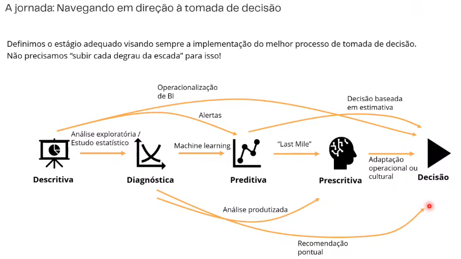

## 🦇 BatCaverna PV - Centro de Comando 2026

---

📅 Data: *12/11/2026** - *Quinta Feira*

*Segunda Feira* = Root Chakra + Academia

- [x] treinamentos
- [x] Meta de estudos uff
- [ ] Meta de programação github - 40h
- [x] Beber dois litros de agua
- [ ] Meditação e Santo terço do dia

*Terça Feira* = Throat Chakra + Circuitos CC e CD + Terapia
*Segunda Feira* = Root Chakra + Academia

- [x] treinamentos
- [x] Meta de estudos uff
- [x] Meta de programação github - 40h
- [x] Beber dois litros de agua
- [ ] Meditação e Santo terço do dia

*Quarta Feira* = Heart Chakra + Homeoffice + Artigo TCC

- [ ] treinamentos
- [x] Meta de estudos uff
- [x] Meta de programação github - 40h
- [x] Beber dois litros de agua
- [ ] Meditação e Santo terço do dia

*Quinta Feira* = Third Eye Chakra + Circuitos CC e CD + Karate

- [ ] treinamentos
- [x] Meta de estudos uff
- [ ] Meta de programação github - 40h
- [x] Beber dois litros de agua
- [ ] Meditação e Santo terço do dia

*Sexta Feira* = Solar Chakra + Dia de Oxalá + Dia que Jesus Cristo sacrificou sua vida

- [ ] treinamentos
- [ ] Meta de estudos uff
- [ ] Meta de programação github - 40h
- [ ] Beber dois litros de agua
- [ ] Meditação e Santo terço do dia

*Sabado* = Folga + Rotina + Futebol + Jogos

*Domingo* = Dia de Missa e Familia

---

# 01) SUMÁRIO

# 02) **JOBS**

### Trabalho Cientista de dados JR no ELITE Rede de Ensino

- Análise de Dados utilizando, VBA, Python, Excel e Power BI.
- Sistemas web com JavaScript em Planilhas Google.
- Dashboards em Excel e Streamlit.
- Correção de simulados e provas de alunos do militar e 9 ano usando VBA e Python.

### Trabalho 2023-2024: Estagio: Camorim Serviços Marítimos de Engenharia Elétrica

- Uso de Visão computacional com Python para manipulação e extração de informações em Documentos PDF e notas fiscais de compras com OCR e Regex.
- Automações e Análise de dados com Python.
- Desenvolvimentos de Web Apps para gestão e manutenção usando Flutter e IA generativa
- Planos de manutenção Corretiva, Preventiva e Diagnóstica
- Criação e acompanhamento de Relatórios Técnicos da oficina elétrica.

### Estagio de Engenharia Elétrica: ONS PLC (Planejamento de Curto prazo)

- Análises de Estudos Elétricos em Regime Permanente (estático) para área de SP de 135KV, 345KV e 440 KV
- Estudos e planejamento de curto prazo para Sistemas Elétricos de Potência do SIN usando simuladores em Python, AnaREDE, ANATEM e Organon.
- Diagramas da área de SP no Organon

- [x] Guia de Montagem Mensal Word x Anotações Obsidian (VA,VB e SEMENTE)
- [x] Relatório de Perdas Duplas LTs usando VBA e Plots de 3 gráficos
- [x] Guia de Montagem de Decks: Mensal (Word + Obsidian)

- [x] Guia completo em Word e PDF dos processos de atividades do mensal usando simuladores CEPEL e FLOW (Redespacho)

- [x] Montagem de Quadros Mensal e Quadrimensal (Flow)

  - VA = Decks de Configuração e Carga para casos SEMENTE
    - Correção barras ausentes
    - Planilha SISBAR: Parecer da Área (fix_decks_barras_ausentes.py) = Retorna uma planilha atualizada comparando as barras ausentes do Mes atual e mes anterior utilizando as Respostas PLC no caso correspondente para região SECO
    - Decks Eletrico/PRD: Script para comentar barras ausentes nos casos (ler_decks_de_carga.py)
  
  - VB = Redespacho de Usinas na FLOW usando politica energética + Case Manager no Organon para Fluxo de Potencia Ótimo.
  
  - VC = Intercambios
  - VD = FLUPOT
  - VF = Ajustes finos de tensão e carga para SECO
  - VG = AnaTEM
  - VH = Emissão do Relatórios

---

### Cientista de dados JR (Python, Julia, Javascript)

- "Agendamento ótimo de manutenção de Redes Elétricas utilizando otimização com algoritmos genéticos e um simulador Desktop usando Python e Pandapower em um sistema elétrico SIN 45 barras da região RJ/SP" (2025)
-
- Dashboards
- Datasets publicos
- Modelos preditivos de series temporais
- Modelos de classificacao ML e DL
- Modelos de recomendação
- Analise de dados com otmização e programação linear

- "Estratégias de diversificação em meta-heurísticas aplicadas a problemas de Otimização em Engenharia Elétrica usando Algoritimos Evolutivos com Python" (2024)
-

## 🎓 Roadmap Cientista de Dados



### Desenvolvedor Desktop IoT

- PyQt6
- QML - KDE - C++
- Rust/Tauri V2
- Electron JS

### Desenvolvedor web

- Pikachu Flask Server
- Rayquaza Web Server - FastAPI
- Kyogre PDV Delivery app
- Gohan Treinamentos Web app
- Astroblog Pedrov12
- Astro Webiste para viagens: Pedro + Vivi <3 <3
- Electrical System Simulator: SEP para leigos
-

- 📋 [Tarefas ONS PLC](#tarefas-ons-plc-2026)

### 🎯 **PROJETOS GITHUB**

- [Projetos GitHub](#projetos-github)

# JOBS 2026

- [ ] Trabalho PJ como DEV R$ 5000 ou U$ 1500 - Como Assistente de Análise de Dados ou dev pleno com Python,C++ ou Javascript

- [ ] Desenvolvedor Fullstack: Software Desktop x Websites x Aplicativos x Dashboards x Robôs x Bots

- [ ] Pesquisa e Desenvolimento UFF + IA + SEP e Simulações em 3D
  - SEP para leigos
  - AnaREDE x Organon x Pandapower(RCE)
  - Otimização linear com AG ou metaheuristicas (Análise de Dados)
  - Astropy x Sympy x Scipy
  - Resumo minicurso: Astronomia como Soberania Nacional

- [ ] Vaga PJ R$ 5000 reais para Analista de dados JR com Python, Javascript, C++, Julia e Lua
  
- [ ] Freelancer SEO com google meu negocio usando webistes vitrine com alcance de clicks dos usuários

# 03) MENTE - Estudos UFF 2026.2 + artigo tcc + astro blog

### 🎯 **DESENVOLVIMENTO PESSOAL**

### Estudos SEP E ONS

- 📚 [Sessão de ESTUDOS](#sessao-de-estudos-matematica-programacao-e-eng-eletrica)

# 04) CORPO - Academia + Calistenia + karate

## ESPÍRITO - Casa de Deus: Cristão Católico + O Livro dos Espíritos

---

# 05) Batcaverna 2026

# 06) Atividades UFF

---

## Estudos UFF

- [x] Python e Julia para Astronomia

- [x] Cálculo 1,2,3 e 4 (Até EDOs e Transformada de Laplace - RLC)
- [x] Estatística I
- [x] Estatística II
- [x] Transmissão de calor I
- [x] Fenomemos de transporte (Mecanica dos fluidos)
- [x] Controle e qualidade - Administração (Metodos estatísticos)

- [ ] Sinais e Sistemas
- [x] Cálculo 2 e 3 (cálculo vetorial)
- [x] Calculo Vetorial com Metodos Numéricos em Julia usando apenas Cálculo 1 e Plots no youtube

- [x] Programação para Data Science (Julia, Plots.jl, Pandas, Plotly, Scipy, sympy)

- [ ] minicurso circuitos CC com Sadiku e Python

- [x] Circuitos Digitais I
  - [x] P1: Codigo de hamming, sistemas de numeracação, teoremas booleanos, circuitos logicos combinacionais, mapa de Karnaugh
  
- [x] Circuitos Elétricos CC
  - [x] P1
    - 5 Provas antigas
    - LKC, LKT, Divisor de tensão, divisor de corrent, Potencia em resistores, amplificadores

  - [ ] Minicurso CC - Falstad e Python/Julia
  - [x] P2
    - Analise Nodal
    - Super Nó
    - Analise Malhas
    - Super Malha
    - Linearidade e Superposição
    - Thevenin
    - Norton
    - Transformação de fontes
    - Máx. Transferencia de potencia

  - [ ] P3
    - Circuitos RL
    - Circuitos RC
    - Circuitos RLC
    - Taxa de amortecimento
    - EDO -> Laplace

- [x] Robotica para Iniciantes
  - Conceitos basicos Arduino e programacao em C++
  - Sensor ultrassonico, Motores e Drivers, Sensor de reflatancia, sensor lateral, motores
  - Sketch POO e funcional de um robo lutador por fluxogramas

- [ ] Programação em C++ e RPA com Python e Shell Script com conexões API com flask e FastAPI

- [x] Cálculo 1,2,3 e 4 (Até EDOs e Transformada de Laplace - RLC)
- [x] Estatística I
- [x] Estatística II
- [x] Transmissão de calor I
- [x] Fenomemos de transporte (Mecanica dos fluidos)

- [ ] FastAPI x Flask x Django x Drogon C++ x Nodejs(express) - projetos backend

- [ ] Estudos de Somatorios, Funções de
 Potencias, Circuitos Eletricos CC e Circuitos Digitais

- [ ] Matriz admtancia + Geração x Transmissão e Distrbuição SIN pelo ONS

- [ ] Metodos númericos em Matlab para engenharia usando Python (pelo livro de moetodos numericos)

- [ ] Solver ML/DL para cada X,Y de conjunto de dado

- [ ] Python com Sympy para calculo de EDO de 1 e 2 ordem para Circuitos CC (RL,RC e RLC)

---

## Estudos Elétricos do ONS para SEP

- Transformador em Fase
- Geradores, Reatores e Transformadores com suas linhas de transmissão. 3 bus, 5 bus, 7 bus...
- Barra swing
- Reator Shunt
- Barras PQ E PV
- Transformador em Fase
- Ferramentas FLOW 9.0
- anaRede x Organon x Pandapower
- Casos Máxima e Mínima (Noturna e Diurna)
- Inércia do sistema
- análise de circuitos RLC com impedância e reatância (capacitiva ou reativa)
- Potência Ativa x Reativa
- fluxo de potência e Curto circuito

- Transmissão X Geração X Distribuição
- RCE: Agendamento ótimo de análise de contingências para intervenções no Sistema Elétrico
-

---

# Tarefas e Estudos Pendentes

- [ ] Circuitos Elétricos CA
- [ ] Eletromagnetismo I - Campos estáticos
- [ ] Sistemas de controle I, II e III
- [ ] Análise de SEP I, II
  - Teorema de Norton e Thevenin
  - Máx de transf. de potência
  - Fluxo de potência
  - Curto circuito
  - Barra Swing

- [ ] IEEDs
- [ ] Sistema de computação

# Livros de estudos e tecnologia

- [ ] Eletromagnetimo + Circuitos Elétricos CC -> Sadiku
- [ ] Como programar em C++ (Deitail)
- [ ] Circuitos CA - Sadiku

- [ ] Python para analise e engenharia de dados usando aprendizado de maquina em projetos reais

- [ ] Banco de dados (C.J Date) 7ed
  - Normalização de dados
  - Relacionamento de tabelas
  - Modelagem em SQL
  - Cardialidade x Integridade
  - Arquitetura de banco de dados
  - Algebra e calculo relacional
  - Segurança e Otimização

- [ ] Eng. de Software: Uma abordagem profissional - Roger S. Pressman

- [ ] Otimizações em Julia
  - basico
  - funções
  - fisica 1 - mecanica
  - fisica 2 - eletromagnetismo
  - fisica 2 e 3 - Optica e Ondas

- [ ] SEP - Stevenson

- [ ] Ogata - Sistema de Controle moderno

- [ ]  Elementos de eletronica digital - Capuano e Edoeta - 42ed

- [ ] Código limpo
  - Como escrever bons códigos
  - Como dar nomes a funções e objetos
  - Tratamento de erros
  - Legibilidade
  - Testes TDD
  - Desenvolvimento voltado a testes
  
- [x] Storytelling com dados

- [ ] Statistcs: A very short introduction

- [ ] Learn analytics - Use Data to build a better startup faster - Eric Ries

- [ ] Data Strategy - Bernard Marr - How to profit from a world of big data. analytics and the IoT

- [x] Eletronica para makers

- [ ] Eletronica prática para inventores - 3ed - Scherz and Monk

---

## Estudos UFF 2027.1

- [ ] Circuitos CA
  - [ ] Impedancia complexa
  - [ ] Reatancia capactitiva
  - [ ] Reatnacia indutiva
  - [ ] Teorema de Thevenin e Norton
  - [ ] Max. Transferência de Potência
s

- Sinais e Sistemas

- Eletromagnetismo

- Termodinamica

---

---

title: Diario de bordo Setembro
author: Mestre Pedro Victor (PVRV)
date: 2026-09-19
format:
  html:
    toc: true
    theme: dark
    code-fold: true
---

# 🚀 Introdução

(10/11/2026)

- É fim do inverno e inicio da primavera...
- é o fim de vicios e inicios de bons hábitos...
- é o fim de relacionamento com a Vivi... mas eu amo ela e preciso ser melhor
- é o fim de espera de um noco emprego e melhorar os 3 curriculos com geração de conteudo semanal e meta mensal para financias, astronomina, eng. eletrica, enem e analise de dados
- fatam 14 dias para minha pŕoxima prova e estou a 0 dias lúcido e sem névoa mental

---

# C++ How to program (8th)

Chapter 1Introduction to Computers and C++

Design patterns Design patterns areprovenarchitectures for constructingflexible and maintainable object-orientedsoftware.The fieldofdesignpatternstries to enumeratethose recurringpatterns, encouragingsoftware designersto reuse them to develop better-qualitysoftwareusing less time,moneyand effort.

LAMP MySQLisanopen-source database managementsystem. PHPisthe most popularopen-source server-sideInternet“scripting” language for developingInternet-basedapplications. LAMP is an acronymfor theset of opensource technologies that many developers use to build webapplications— it standsfor Linux,Apache, MySQLand PHP(or Perl or Python—two otherlanguages usedfor similarpurposes).

Software as a Service(SaaS) Software hasgenerally been viewed as aproduct;mostsoftware stillis offeredthis way. If youwant to runanapplication, youbuy asoftware packagefroma software vendor—often aCD, DVDorweb download. Youtheninstall that software on your computer and runitasneeded.As newversions of thesoftware appear,you upgradeyour software,often requiringsignificant time and at considerable expense. Thisprocess can become cumbersomefor organizations with tens of thousands of systems that must be maintained on adiverse arrayofcomputerequipment.With Softwareasa Service(SaaS),the software runs on serverselsewhereonthe Internet. When that server is updated, allclients worldwidesee thenew capabilities—no localinstallationisneeded. Youaccess theservice througha browser. Browsers arequite portable,soyou canrun thesame applications on awidevariety of computersfromanywhereinthe world. Salesforce.com,Google, and Microsoft’s Office Live and WindowsLiveall offerSaaS.

Platform as a Service(PaaS) Platformasa Service(PaaS) provides acomputing platformfor developingand running applications as aservice over theweb,ratherthaninstallingthe toolsonyour computer.PaaS providersincludeGoogle App Engine, AmazonEC2, Bungee Labs and more.

Cloud computing SaaS andPaaS areexamplesof cloudcomputing in which software,platformsand infrastructure (e.g.,processingpower andstorage) arehosted on demand over theInternet. Thisprovidesusers with flexibility,scalability and cost savings. Forexample,considera company’s data storageneeds which canfluctuate significantlyoverthe course of ayear. Ratherthaninvestingin large-scalestorage hardware—which canbecostlytopurchase, maintain andsecure, andwould most likely notbeusedtocapacityatall times—the company couldpurchasecloud-based services (suchasAmazonS3, Google Storage, Microsoft WindowsAzure™, Nirvanix™and others)dynamically as needed.

Software Development Kit (SDK) SoftwareDevelopmentKits(SDKs) includethe tools and documentation developers use to programapplications.

1) Como funciona os computadores?

1.1) Organização, linguagem de maquina, POO, test-drivin, software technologies

1) Introdução a programação em C++

- Escopo de memória
- aritimética
- tomadas de decisões
- Wrap-Up

1) Introdução ao POO

- Definindo uma classe com funções publicas e privadas
- Funções com parametros
- Geterrs e Setters, Data Members
- Inicializando objetos usando construtores
- Colocando a classe in arquivo separado para *reusabilidade*
- Separando interface da implementação
- Validação de dados som funções setters

1) IF e Else

2) For loop e While

3) Funções e Interações recursivas

- Components em c++
- Bibliotecas de Matemática
- Headers, numeros aleatorios, enum, choice game
- Storage Clsses e Regras de Escopo
- Funções: Overloading, Templates, Recusividade, Serie de fibonacci recursivo

1) array, matrizes e vetores

2) Ponteiros

12-15) Programação orientada a objetos

- Herança
- Polimorfismo
- Abstração
-

 1) processamento de arquivos

 2) Procurando e sorteando elementos em listas e dicionarios

 3) Estrutura de Dados

- Linked lists
- Stacks
- Queues
- Trees
- Grafos

---

---

# Circuitos Digitais

## P1 -Circuitos Lógicos Combinacionais

- Circuitos de 3 e 4 entradas = MOD 4 e MOD 5 = 8 ou 16 combinações de saídas
- TV
- SOP
- MK

## P2 - Circuitos Sequenciais

# Sinais e Sistemas

# Programação em Python (Ciencia de dados)

---

## Livro de referencia: Introdução a programação cientifica com Python - Simula Springer

```py

import math

r = math.sqrt(2)

from math import sqrt

r = sqrt(2)

from math import *

r = sqrt(2)


```

```py
from math import sqrt, pi, exp

print("Exemplo de função Gaussiana")

m = 0
s = 2
r = 1

def func(s,m,r):
    return 1/(s*sqrt(2*pi)) * exp(-0.5*((r-m)/s)**2)


print(func(s,m,r)) 


```

```py

print("Using the function range to loop over indices")

P = 100
r = 5.0
N = 10
for n in range(N+1):
    A=P* (1+r/100)**n
    print(n,A)


def amount(n):
    P = 100
    r = 5.0
    return P*(1+r/100)**n

year1 = 10
a1 = amount(year1) # call
a2 = amount(5) # call

print(a1, a2)
print(amount(6)) # call function

a_list = [amount(year) for year in range(11)] # multiple calls


print("Usando funções como parametros")
def amount(P, r, n):
    return P*(1+r/100.0)**n
# sample calls:
a1 = amount(100, 5.0, 10)
a2 = amount(10, r= 3.0, n=6)
a3 = amount(r= 4, n = 2, P=100)


print("Exmeplo usando a pressao atmosferica")

from math import exp

p0 = 100 # pressao atmosferica no nivel do mar em KPa
h0 = 8400 # scale height (m)

h = 8848 

p = p0 * exp(-h/h0)

print(p)


```

---

# Programação em Python usando testes de funções

```py

def double(x): # some function
    return 2*x
def test_double(): # associated test function
    x=4 # some chosen x value
    expected = 8 # expected result from double(x)
    computed = double(x)
    success = computed == expected # Boolean value: test passed?
    msg = f’computed {computed}, expected {expected}’
assert success, msg


print("Usando um exemplo pratico")

from math import sin, pi
def f(x):
    if 0 <= x <= pi:
    return sin(x)
    else:
    return 0

def test_f():
    x_vals = [-1, pi/2, 3.5]
    exp_vals = [0.0, 1.0, 0.0]
    tol = 1e-10
    for x, exp in zip(x_vals, exp_vals):
    assert abs(f(x)-exp) < tol, \
    f’Failed for x = {x}, expected {exp}, but got {f(x)}’

# rode no terminal

# pytest .

# pytest my_pythoN_script.py


```

# Algebra linear, Numpy e Array computing

```py

def f_quadrada(x):
    return x**2

num_of_points = 5 

dx = 1.0/(num_of_points-1) # x spacing in [0,1]


xlist = [i*dx for i in range(num_of_points)]

ylist = [f(x) for in xlist]

import numpy as np

x = np.array(xlist)
y = np.array(ylist)

print("Matriz X: ")
print(x)
print("Matriz Y: ")
print(y)

```

```py

import numpy as np
from math import cos

def f_quadrada(x):
    return x**2

num_of_points = 5 

x = np.linspace(0,1,num_of_points)

y = np.zeros(n)

print("Função quadratica")

for i in range(n):
    y[i] = f(x[i])

print(x)
print(y)

print("Função Cosseno")

for i in range(n):
    y[i] = cos(x[i])
    #y = np.cos(x)


print(x)
print(y)


```

```py

print("Pontos de curva descritos por essa função")

import numpy as np
import matplotlib.pyplot as plt

n = 100
x = np.linspace(0,4,n+1)
y = np.exp(-x)*np.sin(2*np.pi*x)

plt.plot(x,y)
plt.grid()
plt.show()

```

```py

print("Pontos de curva descritos por essa função")

import numpy as np
import matplotlib.pyplot as plt

def f1(x):
    return np.exp(-x)*np.sin(2*np.pi*x)

def f2(x):
    return np.exp(-2*x)*np.sin(4*np.pi*x)


x = np.linspace(0,8,401) # n = 400 intervals, 401 points, 0 to 8 seconds

y1 = f1(x)
y2 = f2(x)


plt.plot(x,y1, "r--" ,label='f1(x)')
plt.plot(x,y2, "g:" ,label='f2(x)')
plt.xlabel("x")
plt.ylabel("f(x)")
plt.grid()
plt.title("Funções f1 e f2 no mesmo plot ")
plt.legend()
plt.show()

```

# Plotagem de funções e curvas descontinuas ( pag 102 )

```py

print("Introdução a funções descontinuas e suas aplicações na engenharia")

def H(x):
    if x < 0:
        return 0

    else:
        return 1


x = linspace(-10, 10, 5)
y = [H(x)]
plot(x,y)


```

---

# Circuitos Elétricos CC

## P1 - ENEM

## P2 - métodos de analise de circuitos

# SEP e Circuitos CA

# Calculo Numerico

- Derivada implicita
- Derivada direcional
- Integral dupla e triplas
- Curvas de nivel
- Gradiente x Divergente e Rotacional

---

# OLD

---

# Matrizes, Sistemas Lineares, EDO E Algebra linear

```{julia}
using Symbolics
using LinearAlgebra

@variables x y z

A = [x y 2z; 3x y z; x y z]

println(A)

det_A = det(A)
println(det_A)

det_A = substitute(det_A, Dict(x=>2, y => 2, z => 1))
println(det_A)

v1 = [1 2 3]
v2 = [4 5 6]

result = dot(v1, v2) # produto escalar

result = cross(v1, v2) # produto vetorial

B = [x y 2z; 3x y z; x y z]
println(B)

b_inversa = inv(B)
println(b_inversa)

prinln("The inverse of B matrix")
println(B*inv(B))

println("The unit matrix by multiplying a matrix and its inverse")
println(B*B)

```

# ⚡ 1. Circuitos Elétricos CC - EDO de 1 e 2 Ordem (RC / RL / RLC)

****

A análise transiente de um circuito resistor-capacitor (RC) em série excitado por um degrau de tensão $V_s$ é descrita pela seguinte Equação Diferencial Ordinária (EDO):

$$R C \frac{dv_c(t)}{dt} + v_c(t) = V_s$$

Com a condição inicial $v_c(0) = V_0$. A solução geral simbólica é:

$$v_c(t) = V_s + (V_0 - V_s) e^{-\frac{t}{RC}}$$

Abaixo, utilizamos o `SymPy` no Python para resolver a EDO simbolicamente e plotar a curva transiente para $R = 1\ k\Omega$, $C = 1\ mF$, $V_s = 10\ V$ e $V_0 = 0\ V$:

```{python}
#| label: rc-transient
#| echo: true
import sympy as sp
import numpy as np
import matplotlib.pyplot as plt

# 1. Resolução Simbólica via SymPy
t = sp.Symbol("t", real=True, positive=True)
R, C, Vs, V0 = sp.symbols("R C V_s V_0", real=True, positive=True)
vc = sp.Function("v_c")

edo = R * C * sp.diff(vc(t), t) + vc(t) - Vs
sol = sp.dsolve(edo, vc(t), ics={vc(0): V0})

print("Solução simbólica da EDO:")
display(sol)

# 2. Substituição de valores numéricos para plotagem
sol_num = sol.rhs.subs({R: 1000, C: 1e-3, Vs: 10, V0: 0})
v_func = sp.lambdify(t, sol_num, "numpy")

t_vals = np.linspace(0, 5, 500)
v_vals = v_func(t_vals)

# 3. Plotagem do gráfico
plt.figure(figsize=(8, 4))
plt.plot(
    t_vals, v_vals, label="$v_c(t)$ (Tensão no Capacitor)", color="#00ffff", linewidth=2
)
plt.axhline(10, color="red", linestyle="--", label="$V_s$ (Tensão da Fonte = 10V)")
plt.title("Resposta ao Degrau do Circuito RC", color="white")
plt.xlabel("Tempo (s)", color="white")
plt.ylabel("Tensão (V)", color="white")
plt.grid(True, linestyle=":", alpha=0.6)
plt.legend()
plt.show()
```

---

# Conceitos básicos de programação Cientifica em Julia com aplicações de física e engenharia elétrica

```{julia}

using Symbolics

@variables x

@variables x y z


f1 = x²

value_f1 = substitute(f, (x=>3))

value2_f2 - substitute(f, (x => sqrt(3)))


x_values = 0:1:4
f_values = map(x -> f1, x_values)

f_num_values = map(i -> substitute(f1, (x => i)), x_values)

f2 = 3x² = 4log(y) - exp(-z)
f2_valor = substitute(f2, Dict(x => 2, y => 2, z => 3))


```

## Funções trignometricas e Transf. de Laplace

```{julia}

using Symbolics

@variables x

@variables x y z

f2 = 3x² = 4log(y) - exp(-z)

f3 = sin(x)² + cos(y)²
f3_valor = substitute(f3, Dict(x=> deg2rad(30), y => deg2rad(30)))
f3_valor_2 = substitute(f3, Dict(x=> pi/6, y => pi/6))


f5 = f3 + f2
f5

```

```{julia}

using Symbolics

@variables x

@variables x y z


f3 = sin(x)² + cos(y)²
println(f3)
simplify(f3)


f7 = 2sin(x)cos(x)

simplify(f7)

expand(f7)


```

---

## Derivadas de funções em Julia

```{julia}
using Symbolics
using Plots

@variables x
@variables x y z

f = (x+1)³

f2 = x² + y³ - sin(x*y)

df_dx = Symbolics.derivative(f2,x)
plot(df_dx)


df_dy = Symbolics.derivative(f2,y)
plot(df_dy)

println("Função em 2D: $f2")
println("Derivada em X: $df_dx")
println("Derivada em y: $df_dy")


df_x_value = substitute(df_dx, x=> 2)
println(df_x_value)
plot(df_x_value)

df_xy_valor = substitute(df_dx, x=>2, y=>2)
println(df_xy_valor)
println(df_x2)


# Derivadas parciais de ordem superior

df_x2 = Symbolics.derivative(df_x, x)
println(df_x2)

df_x3 = Symbolics.derivative(df_x2, x)


df_y2 = Symbolics.derivative(df_y, y)


df_y3 = Symbolics.derivative(df_y2, y)
```

## Numeros complexos e Transf. de Fourier

---

# 🧲 2. Eletromagnetismo: Equações de Maxwell e Leis Fundamentais

As quatro Equações de Maxwell descrevem de forma unificada os fenômenos elétricos e magnéticos. Na forma diferencial no vácuo:

### I. Lei de Gauss para a Eletricidade

Indica que cargas elétricas são fontes ou sumidouros de linhas de campo elétrico:
$$\nabla \cdot \mathbf{E} = \frac{\rho}{\varepsilon_0}$$

### II. Lei de Gauss para o Magnetismo

Indica que monopólos magnéticos não existem; as linhas de campo magnético são sempre fechadas:
$$\nabla \cdot \mathbf{B} = 0$$

### III. Lei de Faraday da Indução

Mostra que a variação temporal de um campo magnético induz um campo elétrico rotacional (princípio de funcionamento de geradores e transformadores):
$$\nabla \times \mathbf{E} = -\frac{\partial \mathbf{B}}{\partial t}$$

### IV. Lei de Ampère-Maxwell

Descreve como correntes elétricas e variações de campo elétrico (corrente de deslocamento de Maxwell) geram campo magnético:
$$\nabla \times \mathbf{B} = \mu_0 \mathbf{J} + \mu_0 \varepsilon_0 \frac{\partial \mathbf{E}}{\partial t}$$

---

# 🔢 3. Otimização de Recursos em Julia (JuMP & HiGHS)

A otimização linear é fundamental no despacho econômico de energia e alocação de recursos. Abaixo, formulamos um problema para minimizar o custo de geração de energia atendendo a uma demanda mínima de $100\ MW$:

$$\min_{x_1, x_2} \quad 20 x_1 + 30 x_2$$

Sujeito a:
$$x_1 + x_2 \ge 100 \quad \text{(Atendimento da Demanda)}$$
$$0 \le x_1 \le 80 \quad \text{(Limite do Gerador 1)}$$
$$0 \le x_2 \le 60 \quad \text{(Limite do Gerador 2)}$$

A modelagem é feita em Julia com **JuMP.jl** e resolvida pelo solver **HiGHS**:

```{julia}
using JuMP
using HiGHS
using DifferentialEquations
using Plots

# EDO y'' + y = 0, escrita como um sistema de primeira ordem:
# y' = v e v' = -y. As condições iniciais geram seno e cosseno.
function oscilador!(du, u, p, t)
    du[1] = u[2]
    du[2] = -u[1]
end

intervalo = (0.0, 2π)
sol_seno = solve(ODEProblem(oscilador!, [0.0, 1.0], intervalo),
    Tsit5(), saveat=0.01)
sol_cosseno = solve(ODEProblem(oscilador!, [1.0, 0.0], intervalo),
    Tsit5(), saveat=0.01)

tempo = sol_seno.t
seno = [u[1] for u in sol_seno.u]
cosseno = [u[1] for u in sol_cosseno.u]
tangente = [abs(c) > 1e-6 ? s / c : NaN for (s, c) in zip(seno, cosseno)]
cotangente = [abs(s) > 1e-6 ? c / s : NaN for (s, c) in zip(seno, cosseno)]

grafico = plot(tempo, seno, label="sen(t)", linewidth=2,
    xlabel="t (rad)", ylabel="valor", title="Funções trigonométricas via EDO")
plot!(grafico, tempo, cosseno, label="cos(t)", linewidth=2)
plot!(grafico, tempo, tangente, label="tan(t)", linestyle=:dash)
plot!(grafico, tempo, cotangente, label="cot(t)", linestyle=:dot)
ylims!(grafico, (-5, 5))
savefig(grafico, "funcoes_trigonometricas_edo.png")

# Inicializar modelo
modelo = Model(HiGHS.Optimizer)

# Variáveis
@variable(modelo, x1 >= 0)
@variable(modelo, x2 >= 0)

# Função Objetivo
@objective(modelo, Min, 20*x1 + 30*x2)

# Restrições
@constraint(modelo, rest_demanda, x1 + x2 >= 100)
@constraint(modelo, cap_gerador1, x1 <= 80)
@constraint(modelo, cap_gerador2, x2 <= 60)

# Resolver
optimize!(modelo)

println("Status: ", termination_status(modelo))
println("Geração G1: ", value(x1), " MW")
println("Geração G2: ", value(x2), " MW")
```

---

# OBS: Como usar Plots em julia?

## Abaixo, um exemplo de resolução de EDOs e plotagem de funções trigonométricas

```{julia}

using Plots

x = range(0, 20, length=300)
y1 = cos.(x)
y2 = sin.(x)

y3 = @. cos(x) .^ 2 - 1/2 # equivalente a y3 = cos.(x).^2 .- 1/2


plot(x, [y1 y2], label=["cos(x)" "sin(x)"], color=:blue, linewidth=2, title="Gráfico de cos(x)", xlabel="x", ylabel="cos(x)")


plot!(x, y3)


```

---

## The three trigonometric functions plots with plot

```{julia}
using Plots
x = range(0, 20, length=200)
y1 = cos.(x)
y2 = sin.(x)
y3 = @. cos(x) .^ 2 - 1/2

plot(x, [y1 y2], label=[], lw=[2 1])
plot!(x, y3, label="cos²(x) - 1/2", lw=2, ls=:dot
)
plot!(legend:outerbottom, legendcolumns=2)
xlims!(0, 2pi)
title!("3 Funções Trigonometricas")
xlabel!("x")
ylabel!("y")
```

```{julia}
using Plots

amostras = 1000

x = randn(amostras)
Plots.histrogram(x)


```

```{julia}
using Plots

amostras = 30

x = randn(amostras)
Plots.bar(x)


```

```{julia}
using Plots
amostras = 20

pie = rand(amostras)
Plots.pie(pie)

```

```{julia}
using Plots
amostras = 2 * 1000

x = 1:200
y = randn(amostras)
Plots.scatter(x, y)

```

```{julia}
using Plots
x = randn(10000)
y = randn(10000)
histogram2d(x, y)

```

```{julia}
using Plots

p(x) = 1/sqrt(2pi) * exp(-2^2/2)
b_range = range(-4, 4, length=27)

histogram(x, label="Exp.", bins=b_range, normalize=:pdf, color=:red)

plot!(p, label="Analise", color=:blue, lw=2)
xlims!(-10, 10)
ylims!(0, 0.5)
title!("Distribuição Normal")
xlabel!("x")
ylabel!("P(x)")

```

---

# 👁️ 4. Visão Computacional com OpenCV (Python)

O processamento digital de imagens permite a filtragem espacial para detecção de bordas e contornos em projetos robóticos.

### Algoritmo de Canny

A detecção de bordas de Canny é um método baseado em multi-estágios:

1. **Suavização**: Aplicação de filtro Gaussiano para remover ruídos.
2. **Cálculo de Gradiente**: Filtro de Sobel para encontrar as intensidades de gradiente horizontal e vertical.
3. **Supressão de Não-Máximos**: Afinamento de bordas espessas.
4. **Limiarização com Histerese**: Classificação de bordas fortes e fracas.

O script `scripts/opencv_demo.py` gera figuras sintéticas e aplica Canny, Sobel e binarização salvando-os localmente como PNGs.

---

# JOBS - Cientista de Dados x Dev JR Fullstack x Eng. Eletricista x Pesquisador

um(a) **Analista de Dados Júnior** para apoiar a implementação e evolução de ferramentas de **Inteligência Artificial, automações e soluções baseadas em dados**, contribuindo para a melhoria de processos e para a construção de novas soluções para o negócio.  
  
Se você é uma pessoa analítica, curiosa, gosta de tecnologia e tem vontade de aprender e experimentar novas ferramentas, essa oportunidade pode ser para você.  

*Etapas do processo seletivo**

- Currículos: Cientista de dados, Eng. Eletricista e Pesquisador, Desenvolvedor de Software e de Redes Fullstack
- Pré-Entrevista
- Mapeamento Comportamental
- Entrevista com equipe de seleção
- Entrevista com Gestor
- Proposta e resultado
  
**Responsabilidades e atribuições  
  
**Como **Analista de Dados Júnior**, você será responsável por:  
  
- Apoiar a implementação e utilização de ferramentas de Inteligência Artificial.
- Criar, testar e acompanhar fluxos automatizados e integrações entre sistemas.
- Apoiar o desenvolvimento e manutenção de automações utilizando APIs.
- Realizar a manipulação, organização e validação de dados.
- Validar dados, textos e resultados gerados por ferramentas e modelos de Inteligência Artificial.
- Apoiar testes e homologações de novas ferramentas, automações e soluções tecnológicas.
- Identificar inconsistências nos dados e resultados das rotinas automatizadas, apoiando a correção dos problemas.
- Apoiar a identificação de oportunidades de automação e melhoria de processos.
- Elaborar e manter documentações das automações, integrações e rotinas desenvolvidas.
- Registrar e acompanhar resultados e indicadores relacionados às rotinas automatizadas.
- Apoiar a criação de relatórios e análises utilizando dados disponíveis.
- Pesquisar e aprender novas ferramentas e tecnologias relacionadas à Inteligência Artificial, automação e dados.  
- Coletar, organizar e tratar dados provenientes de diferentes fontes.
- Desenvolver consultas em SQL para extração e análise de dados.
- Desenvolvimento e manutenção de *DASHBOARDS* e relatórios em Power BI e outras ferramentas de Business Intelligence.
- Auxiliar na criação e acompanhamento de indicadores (KPIs) para apoio à tomada de decisão.
- Realizar análises exploratórias para identificar padrões, inconsistências e oportunidades nos dados.

**Requisitos e qualificações  
  
**Buscamos profissionais que tenham:  
  
- Ensino superior cursando ou completo em Ciência de Dados, Sistemas de Informação, Tecnologia, Engenharia, Estatística ou áreas correlatas.
- Vivência em Python.
- Conhecimento básico em SQL.
- Domínio em Excel ou Google Sheets.
- Noções de manipulação e organização de dados.
- Noções de APIs e integrações entre sistemas.
- Interesse e facilidade para aprender novas tecnologias, especialmente relacionadas à Inteligência Artificial e automação.  

Será considerado diferencial possuir conhecimento ou experiência em:  
  
- Ferramentas de Inteligência Artificial generativa.
- Projetos de Inteligência Artificial, automação ou análise de dados.
- Power Automate, Make, n8n ou ferramentas similares.
- APIs REST.
- Bibliotecas Python para manipulação de dados, como Pandas.
- Power BI ou outras ferramentas de visualização de dados.
- Automação de processos e integração entre sistemas.

### Formação  
  
**Superior completo, porém todos os cursos são bem-vindo

---

um(a) Técnico(a) de Eletrônica para atuar na manutenção de equipamentos eletrônicos e sistemas utilizados nas operações offshore. A posição tem forte característica hands-on: você receberá demandas técnicas, realizará o diagnóstico, executará o reparo ou manutenção necessária, realizará testes e registrará as atividades executadas.  
  
**️ Responsabilidades  
  
- Executar manutenções preventivas, corretivas e preditivas em equipamentos eletrônicos;
- Diagnosticar falhas em equipamentos e sistemas de eletrônica, telecomunicações e navegação;
- Realizar reparos, substituição de componentes, ajustes, calibrações e testes;
- Executar instalação e manutenção de equipamentos eletrônicos embarcados;
- Atuar com equipamentos de comunicação e navegação marítima;
- Realizar testes funcionais após intervenções e reparos;
- Interpretar diagramas, esquemas elétricos e eletrônicos para diagnóstico e manutenção;
- Utilizar instrumentos de medição durante os processos de diagnóstico e reparo;
- Registrar as atividades realizadas, diagnósticos e soluções aplicadas;
- Elaborar e enviar relatórios técnicos referentes aos serviços executados;

**✅ Requisitos  Obrigatórios:

- Curso Técnico completo em Eletrônica, Telecomunicações, Automação ou áreas correlatas;
- Experiência profissional com manutenção de equipamentos eletrônicos;
- Conhecimento de instrumentos de medição, especialmente multímetro e osciloscópio;
- Conhecimento de leitura e interpretação de diagramas e esquemas elétricos/eletrônicos;
- Conhecimentos relacionados a equipamentos de navegação e/ou radiocomunicação marítima.

---

um(a) **Engenheiro(a) de Controle e Automação** para atuar em um projeto de alta complexidade tecnológica, com foco no desenvolvimento, implementação e otimização de sistemas de controle.  
  
️ **Responsabilidades**  
  
- Desenvolver estratégias de controle robusto para compensar movimentos da embarcação e vibrações do ambiente offshore;
- Integrar o sistema de controle da câmera com módulos de visão computacional, detecção e rastreamento de objetos;
- Modelar a dinâmica do sistema câmera–plataforma–embarcação para apoiar o desenvolvimento dos controladores;
- Avaliar o desempenho do sistema com métricas como erro de apontamento, tempo de resposta, overshoot e estabilidade do alvo na imagem;
- Ajustar parâmetros de controle para reduzir erro de apontamento, overshoot e atraso de resposta;
- Apoiar a definição da arquitetura de sistema de controle em tempo real para câmeras PTZ;
- Elaborar documentação técnica, critérios de teste e relatórios de desempenho;
- Atuar de forma integrada com equipes de software embarcado, visão computacional e operações offshore.  

✅ Requisitos  Obrigatórios:  
  
- Modelagem e projeto de sistemas de controle, incluindo PID, feedforward, filtros e compensação.
- Conhecimento em estimadores de estado, como Kalman, EKF e UKF;
- Desenvolvimento em Python ou C/C++.  

Desejáveis:  
  
- Sistemas operacionais Linux e programação em tempo real;
- Integração e comando de câmeras PTZ;
- Integração com GPUs, edge computing ou sistemas embarcados, como Jetson ou similares;
- Familiaridade com visão computacional para detecção e tracking de objetos;
- Experiência com testes em campo e comissionamento de sistemas automatizados.  

‍ Formação Acadêmica  
  
- Ensino superior completo em Engenharia de Controle e Automação, Engenharia Elétrica, Engenharia Mecatrônica, Engenharia Eletrônica, Engenharia da Computação ou áreas correlatas;
- Mestrado ou Doutorado em Controle e Automação, Mecatrônica ou afins. (desejável).

---

um(a) Estagiário(a) de Desenvolvimento Back-end para atuar em uma equipe multidisciplinar que desenvolve uma plataforma Web/PWA para resposta a emergência e exploração sustentável dos oceanos, envolvendo visualização e processamento de dados (históricos, tempo real e previstos) em conjunto com um mapa interativo.  

### 🛠️ Responsabilidades

- Participar do processo de manter arquiteturas de software robustas;
- Auxiliar no desenvolvimento de novas funcionalidades e sustentação de funcionalidades existentes em um contexto de agilidade;
- Colaborar com outras equipes (Frontend, DevOps, QA) para integrar soluções completas e eficientes.  

### ✅ Requisitos

Obrigatórios:

- Cursando Ensino Superior em Sistemas da Informação, Ciências da Computação ou áreas afins, a partir do 3º período;
- Conhecimento em pacote office;
- Conhecimento em estruturas de dados e algoritmos;
- Conhecimento em engenharia de software: versionamento, code review, design de APIs REST;
- Conhecimento em linguagem de programação (especialmente Python);
- Conhecimento sobre bancos de dados relacionais e não relacionais.

Desejáveis

- Conhecimento em: CI/CD e automação de deploys, além de experiência com ambientes de Cloud, preferencialmente Azure;
- Conhecimento de boas práticas de desenvolvimento, utilizando conceitos como Design Patterns, SOLID e Clean Code;
- Familiaridade com frameworks web como Flask e FastAPI, bem como com testes automatizados, incluindo testes unitários e de integração;
- Familiaridade com bibliotecas de processamento de dados, como Pandas e Xarray, além de experiência com a linguagem de programação Go;
- Vivência em domínios náuticos, geoespaciais ou ambientais.

---

um(a) **Desenvolvedor(a) Fullstack** para integrar nosso time de tecnologia e liderar o desenvolvimento de aplicações web progressivas (PWA), aplicativos multiplataforma e dashboards interativos de alta performance.  
A pessoa ideal para essa posição terá sólida experiência em arquitetura de software, desenvolvimento frontend e backend, além de visão estratégica para desenvolver soluções escaláveis, seguras e eficientes.

### 🛠️ Responsabilidades

- Projetar, desenvolver e manter aplicações PWA e dashboards interativos voltados para experiência do usuário e performance;
- Atuar no frontend e backend, garantindo integração fluida entre sistemas e APIs;
- Garantir a segurança, escalabilidade e qualidade das soluções desenvolvidas;
- Aplicar boas práticas de arquitetura, padrões de código e testes automatizados;
- Liderar iniciativas técnicas, orientar desenvolvedores de níveis júnior/pleno e revisar código.

### ✅ Requisitos

**Obrigatórios**:

- Domínio de JavaScript/TypeScript e Python para Web e backend
- Experiência em frameworks de frontend como React, Next.js ou similares;
- Vivência em desenvolvimento backend com Node.js, Go, C# ou equivalentes;
- Experiência no desenvolvimento de PWAs e integração com APIs REST/GraphQL.

**Desejáveis:**

- Familiaridade com Docker, Kubernetes e pipelines DevOps;
- Prática em testes automatizados, CI/CD e boas práticas de versionamento (Git).

---

# ⚡ 1. Circuitos Elétricos CC: Resposta Transiente de 1ª Ordem (RC)

****
A análise transiente de um circuito resistor-capacitor (RC) em série excitado por um degrau de tensão $V_s$ é descrita pela seguinte Equação Diferencial Ordinária (EDO):

$$R C \frac{dv_c(t)}{dt} + v_c(t) = V_s$$

Com a condição inicial $v_c(0) = V_0$. A solução geral simbólica é:

$$v_c(t) = V_s + (V_0 - V_s) e^{-\frac{t}{RC}}$$

Abaixo, utilizamos o `SymPy` no Python para resolver a EDO simbolicamente e plotar a curva transiente para $R = 1\ k\Omega$, $C = 1\ mF$, $V_s = 10\ V$ e $V_0 = 0\ V$:

```{python}
#| label: rc-transient
#| echo: true
import sympy as sp
import numpy as np
import matplotlib.pyplot as plt

# 1. Resolução Simbólica via SymPy
t = sp.Symbol("t", real=True, positive=True)
R, C, Vs, V0 = sp.symbols("R C V_s V_0", real=True, positive=True)
vc = sp.Function("v_c")

edo = R * C * sp.diff(vc(t), t) + vc(t) - Vs
sol = sp.dsolve(edo, vc(t), ics={vc(0): V0})

print("Solução simbólica da EDO:")
display(sol)

# 2. Substituição de valores numéricos para plotagem
sol_num = sol.rhs.subs({R: 1000, C: 1e-3, Vs: 10, V0: 0})
v_func = sp.lambdify(t, sol_num, "numpy")

t_vals = np.linspace(0, 5, 500)
v_vals = v_func(t_vals)

# 3. Plotagem do gráfico
plt.figure(figsize=(8, 4))
plt.plot(
    t_vals, v_vals, label="$v_c(t)$ (Tensão no Capacitor)", color="#00ffff", linewidth=2
)
plt.axhline(10, color="red", linestyle="--", label="$V_s$ (Tensão da Fonte = 10V)")
plt.title("Resposta ao Degrau do Circuito RC", color="white")
plt.xlabel("Tempo (s)", color="white")
plt.ylabel("Tensão (V)", color="white")
plt.grid(True, linestyle=":", alpha=0.6)
plt.legend()
plt.show()
```

---

# 🧲 3. Eletromagnetismo: Equações de Maxwell e Leis Fundamentais

As quatro Equações de Maxwell descrevem de forma unificada os fenômenos elétricos e magnéticos. Na forma diferencial no vácuo:

### I. Lei de Gauss para a Eletricidade

Indica que cargas elétricas são fontes ou sumidouros de linhas de campo elétrico:

$$\nabla \cdot \mathbf{E} = \frac{\rho}{\varepsilon_0}$$

### II. Lei de Gauss para o Magnetismo

Indica que monopólos magnéticos não existem; as linhas de campo magnético são sempre fechadas:

$$\nabla \cdot \mathbf{B} = 0$$

### III. Lei de Faraday da Indução

Mostra que a variação temporal de um campo magnético induz um campo elétrico rotacional (princípio de funcionamento de geradores e transformadores):

$$\nabla \times \mathbf{E} = -\frac{\partial \mathbf{B}}{\partial t}$$

### IV. Lei de Ampère-Maxwell

Descreve como correntes elétricas e variações de campo elétrico (corrente de deslocamento de Maxwell) geram campo magnético:

$$\nabla \times \mathbf{B} = \mu_0 \mathbf{J} + \mu_0 \varepsilon_0 \frac{\partial \mathbf{E}}{\partial t}$$

# 🧠 Diário de Bordo Agosto - Exemplo

Bloqueios?

Questões emocionais

Falta de rotina x Organização e Planejamento

Abstinencia de maconha de 4 dias. Fumei domingo e segunda para aliviar, mas me deu sono e apenas tesão

Falta de foco e clareza no que seguir nos estudos: Ciência de Dados e Eng. Elétrica

Falta de segurança em mim mesmo

⚡ Notas de Física 3 (Randall Knight) e Notas de Cálculo 3 (Hamilton Guidorizzi)

Tópico de Estudo:

Escreva o capítulo e tema aqui (Ex: Lei de Gauss, Campo Elétrico, Potencial)

Equações Principais:

Utilize as expressões em LaTeX abaixo para formatar as fórmulas do livro:

- Lei de Gauss:

$$\oint \vec{E} \cdot d\vec{A} = \frac{Q_{int}}{\epsilon_0}$$ - Campo Elétrico de uma Carga Pontual: $$\vec{E} = \frac{1}{4\pi\epsilon_0} \frac{q}{r^2} \hat{r}$$

Exercícios Resolvidos & Insights:

Anote a resolução passo a passo dos exercícios.

Aplicações na Engenharia

Gradiente

Vetor Gradiente:

$$\nabla f(x, y, z) = \left( \frac{\partial f}{\partial x}, \frac{\partial f}{\partial y}, \frac{\partial f}{\partial z} \right)$$

Rotacional

Divergente

Integral Triplas em Coordenadas Esféricas e Cilíndricas

Integral Dupla em Coordenadas Polares: $$\iint_D f(x,y) \, dA = \iint_{D'} f(r\cos\theta, r\sin\theta) \, r \, dr \, d\theta$$

Cálculo Vetorial

Equações Principais: (Teorema de Green, Gradiente, Integral definida da engenharias)

Fórmulas Úteis:

Demonstrações & Exercícios:

Anote suas deduções matemáticas aqui.

---

# DIÁRIO DE BORDO - NOVEMBRO DE 2026

03-11-2026:

- CIRCUITOS DIGITAIS I
- CIRCUITOS RL, RC E RLC
- OTIMIZAÇÃO DE SEP
- SISTEMA DE CONTROLE MODERNO
- PYTHON, VBA, SQL, JAVASCRIPT (NODEJS), C++, LUA, JULIA E FLUTTER
- AG - PYQT6

---

# 07) Corpo x Mente X Espírito = Equilíbrio

## Mundo espiritual

- alinhamento espíritual do dia
- rotina de evangelho do dia e salmos
- leitura de Gênesis, Evangelho, Profetas e Profecias, Atos dos apóstolos, Apocalipse

- periodos do calendário católico

- santo terço e Detox de pensamento ruins e diminuição de ansiedade

- Curso Raízes de Aruanda e postagem no blog

- previsão março de 2026 - hudd (conversar com o bruxo)

- previsão maio e junho de 2026 - hudd

- 2 missões espirituais em 60 dias
- "ensinar a fazer certa pessoa próxima a encontrar seus talentos no meio de trabalho"

- "minha mente funciona de forma diferente, eu vim para incomodar. Estou aqui para questionar e demonstrar matemática e cientificamente falando assuntos que instiguem na evolução da raça humana."

- estado de espírito

- Aura, Espírito e Mente

- Campo energético vibracional do ser humano (potencial do campo elétrico do cérebro)

- sessões de confissões de pecados com terço da misericórdia com exame de consciência

---

# 08) PVRV 2026 Notes

# Rotinas de Dono de Casa (Homem TDAH Adulto)

- [x] Disciplina e Responsabilidade
- [x] Tomar banho gelado
- [x] Vestir roupas limpas
- [x] Lavar o Rosto e fazer Skin Care
- [x] Exercicio Físicos
- [x] Alongamento de Quadril, Ombra, Colunas e Core
- [x] Limpeza arpatamento
- [ ] Alinhamento Espiritual matinal
- [ ] Banho Gelado - Detox de Dopamina (Banheira de gelo)
- [ ] Rotina = Saúde Mental
- [ ] Organização + Planejamento = SCRUM
- [ ] Exercicíos físicos + Alongamentos = Saúde Física + Mental

---

# Jogos

- [x] FIFA 19 - Modo Carreira 19 e 26
- [x] COD Black OPS 1 - Guerra Fria
- [x] COD Black OPS 2 - 2025 Guerra moderna
- [x] SMITE 2 ou League of Legends Classic ou Dota 2
- [x] The witcher 3
- [x] Pokemon Radical RED
- [x] FIFA 14:
  - <https://www.reddit.com/r/FifaCareers/comments/1rjnorf/how_to_download_fifa_14_on_pc_for_free/?tl=pt-br>
  - <https://drive.google.com/file/d/1c8R35D2lMrK827zOIjWrMJ1jP2j0ipgZ/view>

---

### 🚀 Projetos GitHub

<a id="projetos-github"></a>

- Verifique se o projeto `Github/Pikachu-Flask-Server` esta instalado na sua maquina local: <https://github.com/PedroVic12/Pikachu-Flask-Server>

- Batcaverna Project: GitHub\Pikachu-Flask-Server\batcaverna\batcaverna-project
<https://batcaverna-pv.vercel.app/>

- astro-system: \GitHub\Pikachu-Flask-Server\pikachu-API\astro-system
- quizz Show do milhão: GitHub\Pikachu-Flask-Server\frontend\Quizz_App_For_Studying_With_UI\quizz_show_do_mihao_AI.html
- Kanban PRO NextJS: GitHub\Pikachu-Flask-Server\frontend\project_kanban_pro_2025

- <https://github.com/PedroVic12/getx-for-qt6>

- <https://github.com/PedroVic12/Gohan-treinamentos-web-app>

### 🎯 **LINKS WEBSITES**

- <https://batcaverna-pv.vercel.app/>
- <https://www.mat.ufmg.br/futebol/classificacao-para-libertadores_seriea/>
- <https://gohan-treinamentos-web-app-one.vercel.app/home>
- <https://electrical-system-simulator.vercel.app/>

- Pikachu Rest API:<https://pikachu-restapi.onrender.com/>
- World Monitor: <https://www.worldmonitor.app/>
- SAPECP: <https://sintegre.ons.org.br/sites/SAPECP/Paginas/VisibilidadeCiclos.aspx>

---
