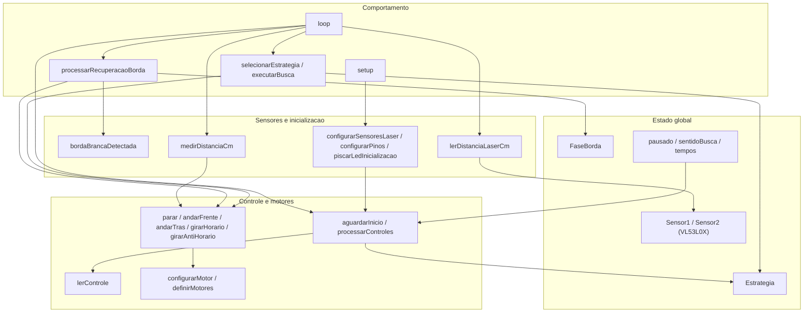
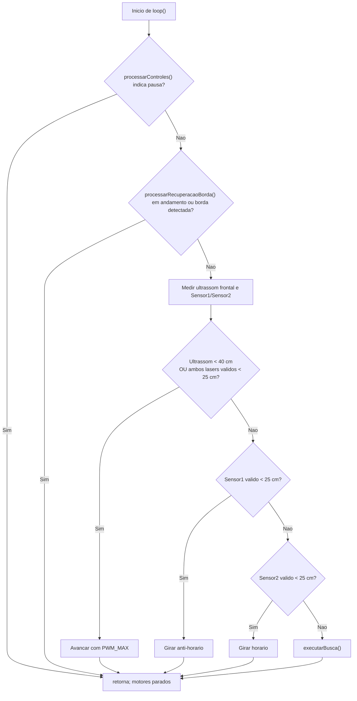
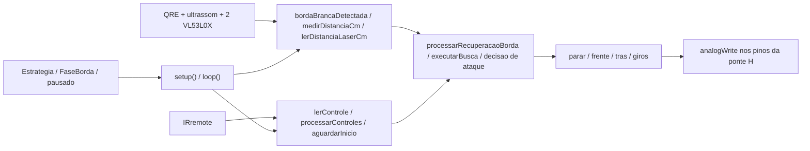
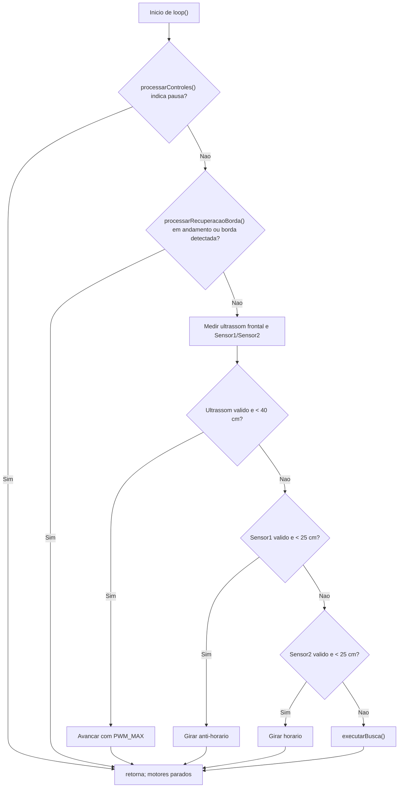
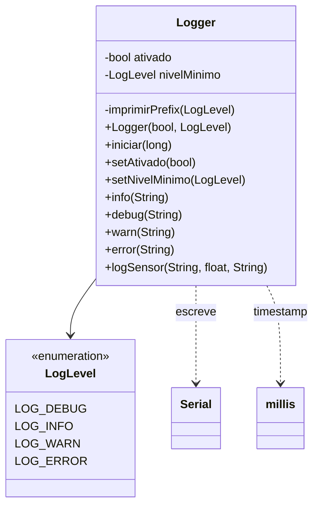
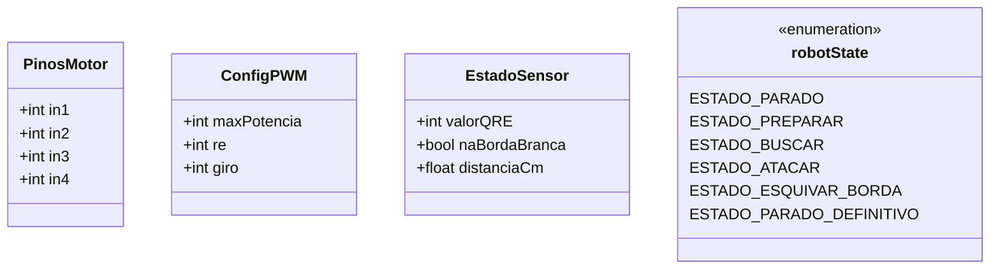
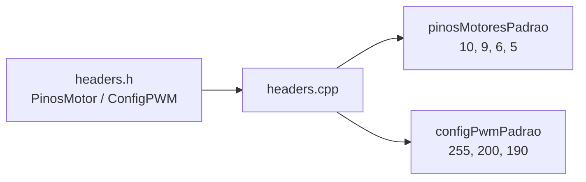
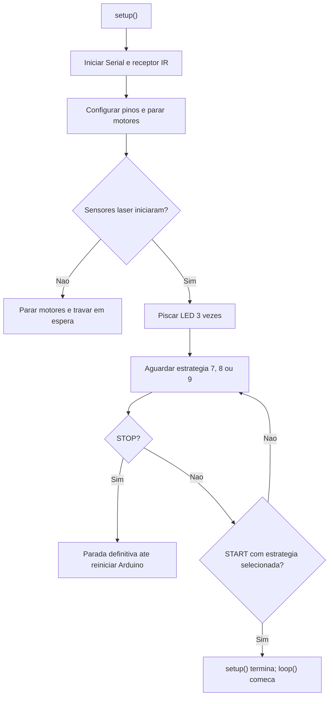

# Documentacao do robo lutador

Este documento descreve os arquivos encontrados nesta pasta. Os diagramas usam Mermaid; para visualiza-los, abra este arquivo em um visualizador compativel, como o preview de Markdown do VS Code.

## Visao geral

Existem tres implementacoes do robo em arquivos `.ino`. Elas compartilham boa parte da logica, mas sao variantes, nao modulos que devam ser compilados juntos. Todas definem funcoes e variaveis globais com os mesmos nomes, como `setup()`, `loop()`, `Sensor1` e `Sensor2`.

`Logger.h`, `headers.h` e `headers.cpp` formam componentes auxiliares separados. Os sketches listados nao incluem `Logger.h` nem `headers.h`; portanto, esses auxiliares nao participam diretamente dos fluxos abaixo.

| Arquivo | Papel |
|---|---|
| `sketch_Carro-Robo-Lutador-V7.ino` | Variante V7, com ataque frontal por ultrassom ou pelos dois sensores laser. |
| `sketch_Carro_Robo_POO-stable.ino` | Variante estavel, com logica de combate semelhante a V7 e parametros diferentes. Apesar de `POO` no nome, o sketch tambem e procedural. |
| `sketch_23-10-2026_grupo1.ino` | Variante do grupo 1; sensores laser podem detectar o alvo individualmente para orientar o giro. |
| `Logger.h` | Classe reutilizavel para logs pela Serial com niveis. |
| `headers.h` | Declaracoes de pinos, configuracao, estruturas e estados do robo. |
| `headers.cpp` | Instancias globais com configuracoes padrao declaradas em `headers.h`. |

> **Compilacao:** os tres `.ino` devem ser tratados como alternativas. Coloca-los juntos como arquivos de um mesmo sketch Arduino pode juntar suas definicoes e causar conflitos de multiplas definicoes. Selecione uma variante por vez. Os arquivos `headers.h`/`headers.cpp` parecem pertencer a outra organizacao de codigo e nao sao usados diretamente pelos tres sketches acima.

## Modelo dos sketches

Os arquivos `.ino` nao declaram classes proprias. Para nao inventar classes que nao existem, os diagramas abaixo mostram os grupos de funcoes e o estado global de cada arquivo.

### `sketch_Carro-Robo-Lutador-V7.ino`

#### Estrutura

#### Fluxo de `loop()`

**Leitura do ciclo:** a parada/pausa tem prioridade; em seguida vem a recuperacao da borda. So depois o robo le as distancias e decide entre atacar, apontar para um sensor que detectou o alvo ou executar a estrategia de busca.

### `sketch_Carro_Robo_POO-stable.ino`

#### Estrutura

O desenho de responsabilidades e igual ao da variante V7: estado global e sensores alimentam as rotinas procedurais de controle, leitura, recuperacao e busca. Este sketch tambem nao declara classes.

#### Fluxo de `loop()`

**Leitura do ciclo:** mesma ordem e mesma condicao de ataque com os lasers da V7. As diferencas de parametros em relacao a V7 estao resumidas na tabela de variantes.

### `sketch_23-10-2026_grupo1.ino`

#### Estrutura

Este sketch tambem e procedural. A diferenca de comportamento mais visivel esta no tratamento das deteccoes laser no fluxo de combate.

#### Fluxo de `loop()`

**Leitura do ciclo:** diferente das outras duas variantes, cada laser pode causar um giro imediatamente; a regra nao exige que os dois lasers detectem o alvo ao mesmo tempo para o ataque frontal.

## Componentes auxiliares

### `Logger.h`

Este e o unico arquivo da pasta que declara uma classe. `Logger` escreve mensagens formatadas em `Serial` e filtra por nivel minimo.

**Fluxo interno:** cada metodo de log verifica se o logger esta habilitado e se o nivel da mensagem passa pelo filtro. Se passar, imprime prefixo com tempo e nivel, seguido da mensagem. `iniciar()` configura a Serial e envia uma mensagem inicial.

### `headers.h`

Este cabecalho declara configuracoes e tipos; nao contem um fluxo de execucao nem uma classe.

O arquivo tambem define codigos infravermelhos, pinos, limiar QRE e distancia de atencao. Esses valores sao declarados com nomes diferentes dos usados nos sketches; nao ha inclusao de `headers.h` nos tres `.ino` documentados.

### `headers.cpp`

Define os objetos globais de configuracao padrao declarados pelos tipos de `headers.h`.

Nao existe `loop()` ou fluxo ciclico neste arquivo: ele apenas inicializa os dados globais.

## Diferencas entre os sketches

| Aspecto | V7 | POO-stable | grupo1 |
|---|---:|---:|---:|
| `PWM_AVANCO_AGRESSIVO` | 255 | 200 | 200 |
| `TEMPO_GIRO` da recuperacao de borda | 900 ms | 500 ms | 500 ms |
| Intervalos das buscas 8 / 9 | 2000 / 2000 ms | 500 / 300 ms | 500 / 300 ms |
| Timeout configurado nos sensores laser | 50 ms | 50 ms | 100 ms |
| Condicao para ataque com laser | Sensor1 **e** Sensor2; avanca | Sensor1 **e** Sensor2; avanca | Sensor1 ou Sensor2 individualmente; gira para o alvo |
| Codigos das estrategias 8 / 9 | `0x88` / `0x87` | `0x87` / `0x88` | `0x87` / `0x88` |

Em todos os tres, o limiar de ataque do ultrassom e 40 cm, o limiar laser e 25 cm, e uma linha branca e detectada quando a leitura analogica e menor que 700 (`BRANCO_E_MAIOR = false`). Confirme os valores com o hardware antes de alterar os limiares.

## Como as funcoes dos sketches trabalham

As funcoes abaixo existem, com pequenas diferencas de parametros, nos tres arquivos `.ino`.

| Funcao | O que faz |
|---|---|
| `lerControle()` | Consulta o receptor IR. Sem dado novo, retorna `0`; com dado, retorna o codigo recebido e libera a recepcao seguinte. |
| `configurarMotor()` / `definirMotores()` | Convertem potencia com sinal em PWM e aplicam a potencia aos dois lados da ponte H. `0` desliga o motor; a potencia e limitada a `-255..255`. |
| `parar()`, `andarFrente()`, `andarTras()`, `girarHorario()`, `girarAntiHorario()` | Atalhos de movimento que definem a potencia dos motores esquerdo e direito. |
| `bordaBrancaDetectada()` | Le o sensor analogico da linha e compara o resultado com `LIMIAR_LINHA`. |
| `medirDistanciaCm()` | Dispara o ultrassom e calcula a distancia pelo tempo do eco. Retorna `999` quando `pulseIn` expira, valor tratado como sem alvo pelo limite de 40 cm. |
| `lerDistanciaLaserCm()` | Le um sensor VL53L0X em milimetros, converte para centimetros e retorna `0` em timeout ou leitura invalida. |
| `configurarSensoresLaser()` | Inicializa o barramento I2C e ativa os sensores um por vez pelos pinos XSHUT, atribuindo enderecos distintos. |
| `configurarPinos()` | Define os modos dos pinos, deixa o TRIG baixo, para os motores e inicia os sensores laser. |
| `pararDefinitivamente()` | Para os motores e entra em repeticao infinita; somente reiniciar a placa permite continuar. |
| `selecionarEstrategia()` / `executarBusca()` | Escolhem o modo de busca. A estrategia 7 avanca; as estrategias 8/9 alternam giros, iniciando em sentidos opostos. |
| `processarControles()` | Trata parada, pausa e retomada antes de qualquer leitura de alvo no ciclo. |
| `processarRecuperacaoBorda()` | Ao detectar a borda, recua por `TEMPO_RE`; depois gira no sentido horario por `TEMPO_GIRO` e retorna a fase normal. Durante essas fases, impede a decisao normal de combate. |
| `piscarLedInicializacao()` | Pisca o LED integrado tres vezes antes de aguardar o comando para iniciar. |

### Pinos e sensores usados pelos sketches

| Componente | Pino/endereco |
|---|---|
| Receptor infravermelho | D11 |
| Sensor de linha | A0 |
| Ultrassom TRIG / ECHO | A2 / A3 |
| XSHUT dos sensores laser | D7 / D8 |
| Enderecos I2C dos sensores laser | 42 / 43 |
| Motor esquerdo, frente / re | D10 / D9 |
| Motor direito, frente / re | D5 / D6 |

Os enderecos I2C sao configurados como valores decimais no codigo. `headers.h` define um pino TRIG diferente (A4), mas esse cabecalho nao e usado pelos sketches descritos; confira qual conjunto de arquivos esta carregado antes de fazer a ligacao.

### Comandos do controle

Nos sketches, `0x80` pausa, `0x81` inicia ou retoma e `0x82` para definitivamente. Os codigos `0x86`, `0x87` e `0x88` selecionam as estrategias 7, 8 e 9; consulte a tabela de diferencas, pois a associacao entre estrategia 8/9 e os dois ultimos codigos varia entre V7 e as outras variantes.

## Sequencia de inicializacao comum

O botao de pausa (`READY_CODE`) e usado durante a operacao. O botao de inicio (`START_CODE`) retoma uma pausa. A parada definitiva (`STOP_CODE`) para os motores e mantem o programa bloqueado ate reiniciar o Arduino.
