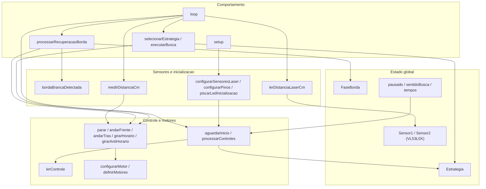
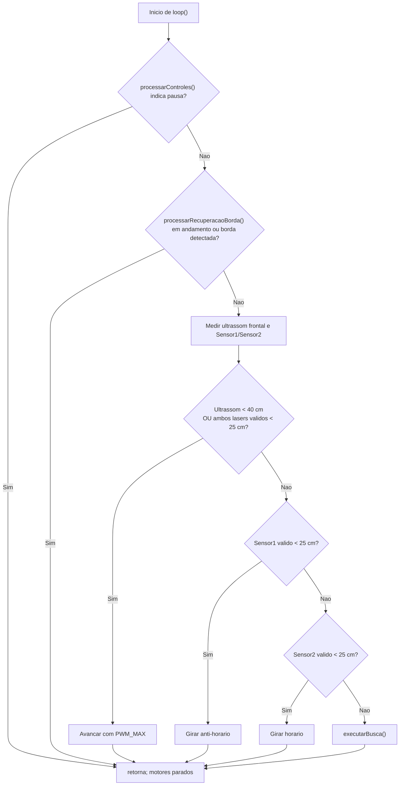
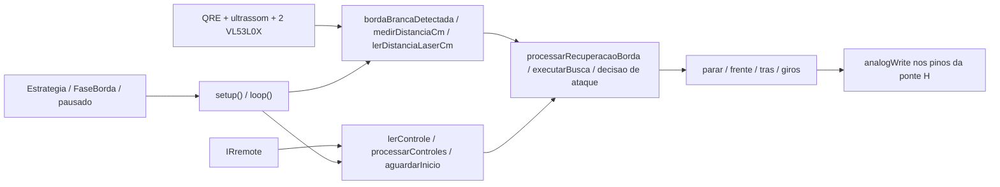
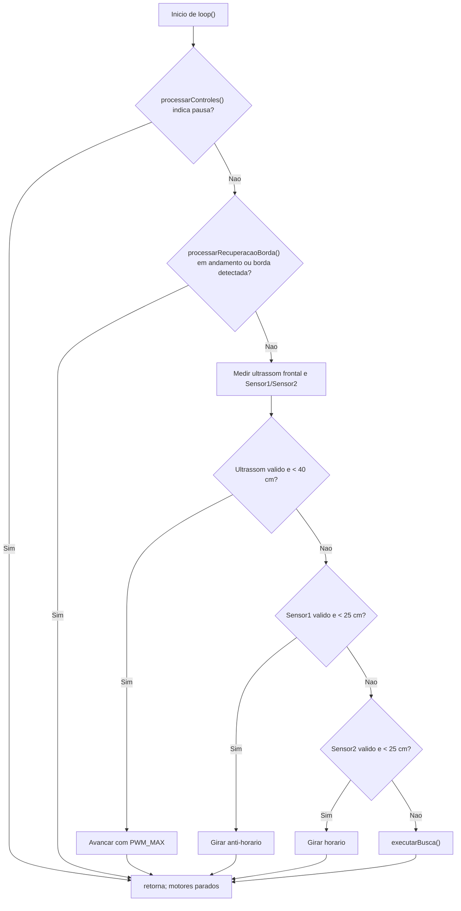
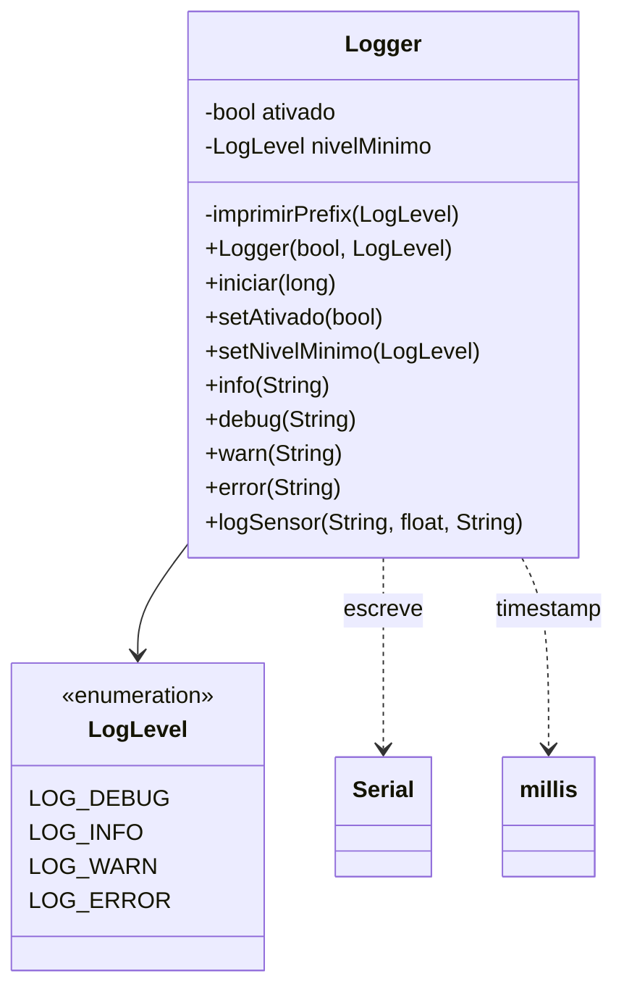
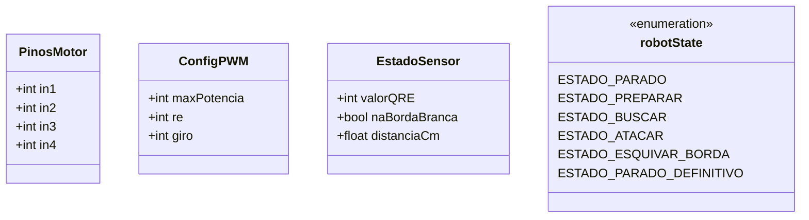
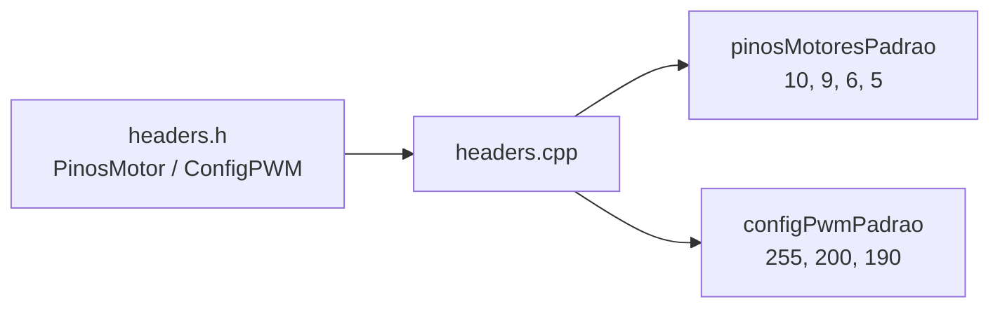
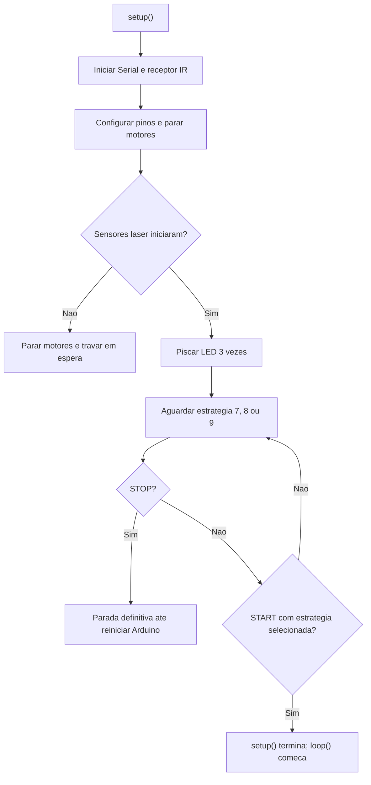

# Fase 0: Conceitos básicos e Fundamentos

- [x] Introdução
- [x] Circuito LED com bateria de 5v
- [x] Circuito Blink (Hello World no Arduino IDE)
- [x] Semáforo
- [x] Comunicação Serial
- [x] Conversão “A/D”
- [x] PWM-Pulse Width Modulation
- [x] Botão Interruptor (Pull Up e Pull Down)
- [x] LED RGB

# Fase 1: Introdução à Robótica e programação em C++

### Componentes que serão utilizados

- Arduino Nano
- Placa de Expansão para Arduino Nano
- Sensor Ultrassônico - HC-SR04
- Sensor de Refletância QRE - Analógico
- Módulo Receptor Infravermelho IR VS1838B KY-022
- Motor DC 3-6V com Caixa de Redução de Aço
- Mini Ponte H Dupla L298N
- Pack de 2 Baterias (2S) Li-Ion 18650 7,4 com Placa BMS.

> **IMPORTANTE**: Mencionem a função do BMS. VL53L0X Sensor de Distância Laser.

# Arquitetura geral

``` text
                 PACK 2S Li-Ion
                   7,4 V nominal
                       │
                 ┌─────┴─────┐
                 │           │
                 ▼           ▼
             L298N        Buck 5 V
           alimentação      │
             motores        │
                 │          ▼
              Motores     Arduino Nano
                             │
                ┌─────────────┼─────────────┐
                │             │             │
                ▼             ▼             ▼
             HC-SR04        QRE          KY-022
           ultrassônico    reflexão       IR
```

Todos os GND precisam estar em comum.

------------------------------------------------------------------------

## 2. Arduino Nano → L298N

| Arduino Nano | L298N | Função      |
|--------------|-------|-------------|
| D5           | ENA   | PWM Motor A |
| D7           | IN1   | Direção A   |
| D8           | IN2   | Direção A   |
| D6           | ENB   | PWM Motor B |
| D9           | IN3   | Direção B   |
| D10          | IN4   | Direção B   |
| GND          | GND   | Ground      |

### Motores

| L298N | Motor         |
|-------|---------------|
| OUT1  | Motor A fio 1 |
| OUT2  | Motor A fio 2 |
| OUT3  | Motor B fio 1 |
| OUT4  | Motor B fio 2 |

Se um motor estiver girando invertido, inverta a polaridade dos fios daquele motor.

------------------------------------------------------------------------

## 3. Alimentação do Arduino Nano

``` text
Bateria 7,4 V ──► Buck 5 V ──┬──► Nano 5V
                             └──► Sensores 5V
```

Entrada e Saída:

``` text
Buck 5V  ─────► Nano 5V
Buck GND ─────► Nano GND
```

E o GND continua comum ao aterramento:

``` text
Nano GND ──┬── L298N GND
           ├── HC-SR04 GND
           ├── QRE GND
           └── KY-022 GND
```

Os sinais PWM e sensores têm a mesma referência elétrica.

------------------------------------------------------------------------

# Missões (27-08-2026)


## 1 Gravação de Código - OK

Procurem o exemplo Blink, disponível na IDE do Arduino, e façam a   gravação do código no Arduino Nano.

```cpp
// The setup function runs once when you press reset or power the board
void setup() {
  // Initialize digital pin LED_BUILTIN as an output.
  pinMode(LED_BUILTIN, OUTPUT);
}

// The loop function runs over and over again forever
void loop() {
  digitalWrite(LED_BUILTIN, HIGH); // Change state of the LED by setting the pin to the HIGH voltage level
  delay(1000);                      // Wait for a second
  digitalWrite(LED_BUILTIN, LOW);  // Change state of the LED by setting the pin to the LOW voltage level
  delay(1000);                      // Wait for a second
}
```

### OBS 1: Programação em C++


### OBS 2: Programação Orientada a objetos


---


## - [x] 2 Comunicação Serial

```cpp
void setup() {
  Serial.begin(9600);
}

void loop() {
  Serial.println("Hello world!");
  delay(1000);
}
```

### OBS: Comunicação Python e Julia e Python e Arduino

## - [x] 3 Sensor Ultrassônico

Façam um código que envie pelo terminal serial a distância lida pelo sensor ultrassônico a cada 1s. Mostrem para um professor que conseguiram cumprir a missão e expliquem o funcionamento do código.

### Forma procedural

```cpp
#define trig 2
#define echo 3

void setup() {
  Serial.begin(9600);
  // Configurando os pinos digitais
  pinMode(trig, OUTPUT);
  pinMode(echo, INPUT);
}

void loop() {
  long duracao;
  float distancia;

  // Gerando o pulso da Onda Digital do sensor ultrassônico
  digitalWrite(trig, LOW);
  delayMicroseconds(2);
  digitalWrite(trig, HIGH);
  delayMicroseconds(10);
  digitalWrite(trig, LOW);

  // Medindo o tempo de retorno
  duracao = pulseIn(echo, HIGH);

  // Calcula a distância em cm
  float vel_som = 0.0343;
  distancia = duracao * vel_som / 2;

  Serial.print("Distancia: ");
  Serial.print(distancia);
  Serial.println(" cm");
  delay(1000);
}
```

---

## - [x] 4 Driver e Motores


código que controle o funcionamento dos motores


```cpp

// variáveis
#define trig 10
#define echo 9

void setup() {
  Serial.begin(9600);

  // Configurando os pinos digitais
  pinMode(trig, OUTPUT);
  pinMode(echo, INPUT);
}


void configSensorUltraSonico() {
  long duracao;
  float distancia;

  // Gerando o pulso da Onda Digital do sensor ultrasonico 
  digitalWrite(trig, HIGH);
  delayMicroseconds(10);
  digitalWrite(trig,LOW);

  // medindo o tempo de retorno
  duracao = pulseIn(echo, HIGH); 

  // calcula a distancia em cm
  float vel_som = 0.0343;
  distancia = duracao * vel_som / 2;

  if (distancia <= 20) {
    Serial.println("\n\nPERIGO!");
  } 
    

  Serial.print("\nDistancia: ");
  Serial.print(distancia);
  Serial.print(" [cm]");
  delay(1000);
}


/*
 * Arduino Nano + L298N
 * 2 motores DC
 */

// Motor esquerdo
const int IN1_MOTOR_ESQUERDO = 10;
const int IN2_MOTOR_ESQUERDO = 9;

// Motor direito
const int IN3_MOTOR_DIREITO = 6;
const int IN4_MOTOR_DIREITO = 5;

// Variáveis e Configurações
const int PWM_max = 255;
const int PWM_50 = 128;
const unsigned long TEMPO_ESPERA = 5000; // 5 segundos


// ======================================================
// MOTOR ESQUERDO E DIREITO - FRENTE
// ======================================================
void moverFrente() {
  digitalWrite(IN1_MOTOR_ESQUERDO, HIGH);
  digitalWrite(IN2_MOTOR_ESQUERDO, LOW);

  digitalWrite(IN3_MOTOR_DIREITO, LOW);
  digitalWrite(IN4_MOTOR_DIREITO, HIGH);
}


// MOTORES - RÉ

void moverRe() {
  digitalWrite(IN1_MOTOR_ESQUERDO, LOW);
  digitalWrite(IN2_MOTOR_ESQUERDO, HIGH);

  digitalWrite(IN3_MOTOR_DIREITO, HIGH);
  digitalWrite(IN4_MOTOR_DIREITO, LOW);
}


void pararMotores() {
  digitalWrite(IN1_MOTOR_ESQUERDO, LOW);
  digitalWrite(IN2_MOTOR_ESQUERDO, LOW);

  digitalWrite(IN3_MOTOR_DIREITO, LOW);
  digitalWrite(IN4_MOTOR_DIREITO, LOW);
}


void girarSentidoHorario() {

  //const int valor = 255 / 2; // entrada analogica variando entre 0 e 255

  // Motor esquerdo → frente
  analogWrite(IN1_MOTOR_ESQUERDO, 0);
  analogWrite(IN2_MOTOR_ESQUERDO, 128);

  // Motor direito → ré
  analogWrite(IN3_MOTOR_DIREITO, 0);
  analogWrite(IN4_MOTOR_DIREITO, 128);
}


void setup() {
  pinMode(IN1_MOTOR_ESQUERDO, OUTPUT);
  pinMode(IN2_MOTOR_ESQUERDO, OUTPUT);

  pinMode(IN3_MOTOR_DIREITO, OUTPUT);
  pinMode(IN4_MOTOR_DIREITO, OUTPUT);

  // Começa parado
  pararMotores();
}

void loop() {

  // 1. ANDAR PARA FRENTE - POTÊNCIA MÁXIMA
  moverFrente(PWM_max);
  delay(TEMPO_ESPERA);

  // 2. Parar e esperar 5 segundos
  pararMotores();
  delay(TEMPO_ESPERA);

  // 3. RÉ - POTÊNCIA MÁXIMA
  moverRe(PWM_max);
  delay(TEMPO_ESPERA);

  // 4. Parar e esperar 5 segundos
  pararMotores();
  delay(TEMPO_ESPERA);

  // 5. GIRAR NO SENTIDO HORÁRIO (PWM = 50%)
  girarSentidoHorario(PWM_50);
  delay(TEMPO_ESPERA);
}
```

---


---

# Missões, Testes de batalaha e algoritimos com funções funcioaniss

## - [x] DESAFIO 1 (Modo Radar)


------------------------------------------------------------------------

## - [x] 6 Sensor de Refletância

#### Código que interprete o sinal de saída do sensor de refletância, indicando quanto o robô está na parte preta da arena e quando o mesmo se encontra em cima da borda branca. Envie o resultado da conversão AD (número de 0 à 1023) e o resultado da análise (PRETO ou BRANCO) pela porta serial, atualizando a informação a cada 1s. Exemplo fictício do texto a ser enviado pelo terminal serial: "512 / PRETO". 


```{cpp}

// PINOS DO SENSOR
#define SENSOR A0

// Limite para diferenciar preto e branco
#define LIMITE 512

// MOTOR ESQUERDO
#define ENA 5
#define IN1 7
#define IN2 8

// MOTOR DIREITO
#define ENB 6
#define IN3 9
#define IN4 10


void setup() {
  Serial.begin(9600);
  pinMode(SENSOR, INPUT);
  pinMode(ENA, OUTPUT);
  pinMode(IN1, OUTPUT);
  pinMode(IN2, OUTPUT);
  pinMode(ENB, OUTPUT);
  pinMode(IN3, OUTPUT);
  pinMode(IN4, OUTPUT);
}

// CONTROLE DOS MOTORES
void parar() {
  analogWrite(ENA, 0);
  analogWrite(ENB, 0);
}

void andarFrente(int velocidade) {
  digitalWrite(IN1, HIGH);
  digitalWrite(IN2, LOW);
  digitalWrite(IN3, HIGH);
  digitalWrite(IN4, LOW);
  analogWrite(ENA, velocidade);
  analogWrite(ENB, velocidade);
}
void andarTras(int velocidade) {
  digitalWrite(IN1, LOW);
  digitalWrite(IN2, HIGH);
  digitalWrite(IN3, LOW);
  digitalWrite(IN4, HIGH);
  analogWrite(ENA, velocidade);
  analogWrite(ENB, velocidade);
}
void girar180() {
  // Um motor para frente e o outro para trás
  digitalWrite(IN1, HIGH);
  digitalWrite(IN2, LOW);
  digitalWrite(IN3, LOW);
  digitalWrite(IN4, HIGH);
  analogWrite(ENA, 255);
  analogWrite(ENB, 255);

  // Ajustar esse tempo de acordo com o robô
  delay(700);
  parar();
}


void loop() {
  // 1. Andar para trás de 10 a 20 cm
  andarTras(180);
  
  // Ajustar o tempo conforme a velocidade do robô
  delay(800);
  parar();
  delay(200);
  
  // 2. Ler o sensor de refletância
  int valorAD = analogRead(SENSOR);
  Serial.print(valorAD);
  Serial.print(" / ");
  
  // 3. Verificar se está na borda branca
  if (valorAD >= LIMITE) {
    Serial.println("BRANCO");
    // 4. Se estiver no branco, girar aproximadamente 180°
    girar180();
  } 
  
  else {
    Serial.println("PRETO");
    
    // 5. Se estiver no preto, andar para frente
    andarFrente(255);
    // Continua andando para frente
    delay(1000);
    parar();
  }
}

```

------------------------------------------------------------------------

## - [x] 7 DESAFIO 2 (Vai e Volta) 11/09/2026


/*
 * INÍCIO
 *   -> Configuração Inicial
 *   -> Interpretar sinal do sensor de reflectância
 *   -> O robô está na borda branca?
 *        SIM -> Andar para trás (10 a 20 cm) -> Girar ~180° -> volta a interpretar o sensor
 *        NÃO -> Andar para frente com potência máxima -> volta a interpretar o sensor
 */

// ---------------- Pinos ----------------

// Sensor de refletância (detecta a borda branca do ringue)
#define SENSOR_LINHA A0

// Motor esquerdo
const int IN1_MOTOR_ESQUERDO = 10;
const int IN2_MOTOR_ESQUERDO = 9;

// Motor direito
const int IN3_MOTOR_DIREITO = 6;
const int IN4_MOTOR_DIREITO = 5;

// ---------------- Configurações ----------------

const int PWM_MAX = 255;   // potência máxima (frente)
const int PWM_RE  = 180;   // potência da ré
const int PWM_GIRO = 180;  // potência do giro

// Tempos (ms) usados para estimar deslocamento/ângulo, já que não há encoder.
// Calibrar na prática de acordo com o robô real.
const unsigned long TEMPO_RE     = 400;  // tempo para andar de ~10 a 20 cm para trás
const unsigned long TEMPO_GIRO   = 650;  // tempo para girar ~180°

// Sensor de refletância: calibrar LIMIAR conforme leitura real de PRETO x BRANCO
const int LIMIAR = 700;

int valorAD;
bool naBordaBranca;


// ======================================================
// LEITURA DO SENSOR DE REFLETÂNCIA
// Atualiza valorAD e naBordaBranca, e envia pela Serial:
// "valorAD / PRETO" ou "valorAD / BRANCO"
// ======================================================
void lerSensorLinha() {
  valorAD = analogRead(SENSOR_LINHA);

  // ajuste o sinal ">" ou "<" conforme a calibração do seu sensor
  naBordaBranca = (valorAD <= LIMIAR); // BRANCO = borda do ringue

  Serial.print(valorAD);
  Serial.print(" / ");
  Serial.println(naBordaBranca ? "BRANCO" : "PRETO");
}

// ======================================================
// ANDAR PARA FRENTE COM POTÊNCIA MÁXIMA
// ======================================================
void andarFrenteMaxima() {
  analogWrite(IN1_MOTOR_ESQUERDO, PWM_MAX);
  analogWrite(IN2_MOTOR_ESQUERDO, 0);

  analogWrite(IN3_MOTOR_DIREITO, 0);
  analogWrite(IN4_MOTOR_DIREITO, PWM_MAX);
}

// ======================================================
// ANDAR PARA TRÁS (de 10 cm a 20 cm)
// ======================================================
void andarParaTras() {
  analogWrite(IN1_MOTOR_ESQUERDO, 0);
  analogWrite(IN2_MOTOR_ESQUERDO, PWM_RE);

  analogWrite(IN3_MOTOR_DIREITO, PWM_RE);
  analogWrite(IN4_MOTOR_DIREITO, 0);

  delay(TEMPO_RE);
  //pararMotores();
}

// ======================================================
// GIRAR ≈ 180°
// ======================================================
void girar180() {
  // Motor esquerdo -> frente
  analogWrite(IN1_MOTOR_ESQUERDO, PWM_GIRO);
  analogWrite(IN2_MOTOR_ESQUERDO, 0);

  // Motor direito -> ré (giro no próprio eixo)
  analogWrite(IN3_MOTOR_DIREITO, PWM_GIRO);
  analogWrite(IN4_MOTOR_DIREITO, 0);

  delay(TEMPO_GIRO);
  //pararMotores();
}


void setup() {
  Serial.begin(9600);

  pinMode(SENSOR_LINHA, INPUT);

  pinMode(IN1_MOTOR_ESQUERDO, OUTPUT);
  pinMode(IN2_MOTOR_ESQUERDO, OUTPUT);
  pinMode(IN3_MOTOR_DIREITO, OUTPUT);
  pinMode(IN4_MOTOR_DIREITO, OUTPUT);

  // Configuração Inicial: começa parado
  //pararMotores();
}

void loop() {
  // ---------- Interpretar o sinal de saída do sensor de reflectância ----------
  lerSensorLinha();

  // ---------- O robô está na borda branca? ----------
  if (naBordaBranca) {
    // SIM
    andarParaTras();
    girar180();
  } else {
    // NÃO
    andarFrenteMaxima();
  }
}


------------------------------------------------------------------------

## - [x] 8 Controle Remoto

O código exemplo pode ser testado no Tinkercad (ver imagem em anexo). No entanto, as linhas 6, 7 e 8 precisam ser modificadas, visto que o modelo de controle utilizado no Tinkercad é diferente do que usamos em sala. Recomendamos que tentem adiantar esta tarefa em casa, pois ela é a mais difícil até o momento.


```cpp

#include <IRremote.hpp>  // Adcionando a biblioteca IRremote

#define IR_RECEIVE_PIN 11  

#define READY_CODE 0x80  // Código da Tecla 1 do controle da Sony
#define START_CODE 0x81  // Código da Tecla 2 do controle da Sony
#define STOP_CODE 0x82   // Código da Tecla 3 do controle da Sony

// -------------------- Motor esquerdo --------------------
#define IN1_MOTOR_ESQUERDO 10
#define IN2_MOTOR_ESQUERDO 9
// -------------------- Motor direito --------------------
#define IN3_MOTOR_DIREITO 6
#define IN4_MOTOR_DIREITO 5

// -------------------- Sensor ultrassônico --------------------
#define TRIG_PIN A4
#define ECHO_PIN A3

// -------------------- Sensor de linha --------------------
#define SENSOR_LINHA A0


// ============================================================
//                 CONFIGURAÇÕES DO ROBÔ
// ============================================================
#define DISTANCIA_LIMITE 20
#define PWM_MAX 255
#define PWM_RE  180
#define PWM_GIRO 180
#define TEMPO_RE 400
#define TEMPO_GIRO 650
#define LIMIAR_LINHA 700

// Sensor refletancia
int valorAD;
bool naBordaBranca;
bool btn_pressed = false;

// Sensor de refletância: calibrar LIMIAR conforme leitura real de PRETO x BRANCO
const int LIMIAR = 700;

// ======================================================
// LEITURA DO SENSOR DE REFLETÂNCIA
// Atualiza valorAD e naBordaBranca, e envia pela Serial:
// "valorAD / PRETO" ou "valorAD / BRANCO"
// ======================================================
void lerSensorLinha() {
  valorAD = analogRead(SENSOR_LINHA);

  // ajuste o sinal ">" ou "<" conforme a calibração do seu sensor
  naBordaBranca = (valorAD <= LIMIAR); // BRANCO = borda do ringue

  Serial.print(valorAD);
  Serial.print(" / ");
  Serial.println(naBordaBranca ? "BRANCO" : "PRETO");
}

// ANDAR PARA FRENTE COM POTÊNCIA MÁXIMA
void andarFrenteMaxima() {
  analogWrite(IN1_MOTOR_ESQUERDO, PWM_MAX);
  analogWrite(IN2_MOTOR_ESQUERDO, 0);

  analogWrite(IN3_MOTOR_DIREITO, 0);
  analogWrite(IN4_MOTOR_DIREITO, PWM_MAX);
}


void MOTORS_CONFIG(void) {
  pinMode(IN1_MOTOR_ESQUERDO, OUTPUT);
  pinMode(IN2_MOTOR_ESQUERDO, OUTPUT);
  pinMode(IN3_MOTOR_DIREITO, OUTPUT);
  pinMode(IN4_MOTOR_DIREITO, OUTPUT);
}

void girar180() {
  // Motor esquerdo -> frente
  analogWrite(IN1_MOTOR_ESQUERDO, PWM_GIRO);
  analogWrite(IN2_MOTOR_ESQUERDO, 0);

  // Motor direito -> ré (giro no próprio eixo)
  analogWrite(IN3_MOTOR_DIREITO, PWM_GIRO);
  analogWrite(IN4_MOTOR_DIREITO, 0);

  delay(TEMPO_GIRO);
  //pararMotores();
}

void PARAR(void) {
  digitalWrite(IN1_MOTOR_ESQUERDO, LOW);
  digitalWrite(IN2_MOTOR_ESQUERDO, LOW);
  digitalWrite(IN3_MOTOR_DIREITO, LOW);
  digitalWrite(IN4_MOTOR_DIREITO, LOW);
}

void FRENTE(void) {
  digitalWrite(IN1_MOTOR_ESQUERDO, HIGH);
  digitalWrite(IN2_MOTOR_ESQUERDO, LOW);
  digitalWrite(IN3_MOTOR_DIREITO, LOW);
  digitalWrite(IN4_MOTOR_DIREITO, HIGH);
}

void RE(void) {

  digitalWrite(IN1_MOTOR_ESQUERDO, LOW);
  digitalWrite(IN2_MOTOR_ESQUERDO, HIGH);
  digitalWrite(IN3_MOTOR_DIREITO, HIGH);
  digitalWrite(IN4_MOTOR_DIREITO, LOW);
}

void RE_COM_POT_MAX() {
  analogWrite(IN1_MOTOR_ESQUERDO, 0);
  analogWrite(IN2_MOTOR_ESQUERDO, PWM_RE);

  analogWrite(IN3_MOTOR_DIREITO, PWM_RE);
  analogWrite(IN4_MOTOR_DIREITO, 0);

}

void andarParaTras() {
  Serial.println("Andando de 10 até 20cm");
  analogWrite(IN1_MOTOR_ESQUERDO, 0);
  analogWrite(IN2_MOTOR_ESQUERDO, HIGH);

  analogWrite(IN3_MOTOR_DIREITO, HIGH);
  analogWrite(IN4_MOTOR_DIREITO, 0);

 
}

void sensorUltrassonicoConfig(int trigPin, int echoPin) {
  pinMode(trigPin,OUTPUT);
  pinMode(echoPin, INPUT);
  digitalWrite(trigPin, LOW);
}


void on_event_button3(){
     // reinicializa o receptor no botão 3
    if (IrReceiver.decodedIRData.decodedRawData == STOP_CODE) {  
      PARAR();

      // gambiarra do professor para parar dentro do loop
      while (1);
    }
}

void on_event_button1(){
    if (IrReceiver.decodedIRData.decodedRawData == READY_CODE) {  
      PARAR();
    }
}

float medirDistancia(int trigPin, int echoPin) {

  long duracao;
  float distancia;
  // Gerando o pulso da Onda Digital do sensor ultrasonico
  digitalWrite(trigPin, HIGH);
  delayMicroseconds(10);
  digitalWrite(trigPin,LOW);

  // medindo o tempo de retorno
  duracao = pulseIn(echoPin, HIGH); 

  // calcula a distancia em cm/s
  float vel_som = 0.0343;
  distancia = duracao * vel_som / 2;

  Serial.print("\nDistancia: ");
  Serial.print(distancia);
  Serial.print(" cm");
  //delay(1000);

  if (distancia < 40) {
     FRENTE();
  } else {
    girar180(); // TODO -> sinais PWM com ciclo de 50% (uma roda para frente e  a outra para trás)

    on_event_button3();

 }
}


  

void configInicial(){
  Serial.begin(9600);                
  
  // receptor infravermelho
  IrReceiver.begin(IR_RECEIVE_PIN);  

  // sensor ultrassonico
  sensorUltrassonicoConfig(TRIG_PIN, ECHO_PIN);
  
  // motores
  MOTORS_CONFIG();

  // Sensor de refletancia
  pinMode(SENSOR_LINHA, INPUT);

}


void onBordaBrancaEvent(){

}


void setup() {

  configInicial();


  // evento de receber dados preso no botão 2
  while (IrReceiver.decodedIRData.decodedRawData != START_CODE) {
    if (IrReceiver.decode()) {  // se algum código for recebido
      IrReceiver.resume();      // reinicializa o receptor

      btn_pressed = true;
    
    }
  }

}

void loop() {

  // Decodificação dos dados do controle remoto
  if (IrReceiver.decode()) {                                     
    IrReceiver.resume();      
  }

  if (btn_pressed) {
      // ---------- O robô está na borda branca? ----------
    if (naBordaBranca) {
      // SIM
      andarParaTras();
      girar180();
    } else {
      // NÃO
      medirDistancia(TRIG_PIN, ECHO_PIN);
      andarFrenteMaxima();
    }
  }

}


```

------------------------------------------------------------------------

## - [x] 9 DESAFIO 3 (Robo Sumô Básico)

Façam um código que controle o funcionamento dos motores de acordo com o fluxograma anexado nesta atividade. Mostrem para um professor que conseguiram cumprir a missão e expliquem o funcionamento do código. Após o professor anotar na planilha de acompanhamento (Checklist) que a tarefa foi cumprida, 1 integrante de cada equipe (apenas 1) deve fazer a entrega do arquivo do Arduino (\*.ino) no Google Classroom. O aluno que entregar a atividade deve indicar (nos comentários) os nomes dos colegas que participaram ativamente do desenvolvimento da tarefa. DICA: Esta missão utiliza conceitos aprendidos nas missões anteriores. Consultem os seus códigos.


------------------------------------------------------------------------

## - [x] 10 Sensores Laterais


1)  Parabéns! Você chegou na última missão da FASE 2 e desbloqueou um item, o sensor de distância laser VL53L0X. Este sensor se comunica com microcontrolador através do protocolo de comunicação I2C. Portanto, antes de iniciar a missão você precisa entender o que é isso. Assista ao vídeo "O que é I2C ? - Explorando o Arduino - Aula 10", disponível no link: https://www.youtube.com/watch?v=3cPDAQvu6ng

2)  Agora que você entende o protocolo I2C é hora de testar o sensor. Estude e teste o código apresentado no artigo "DISTANCE MEASUREMENT WITH VL53LOX", disponível no link: https://arduinoproyek.wordpress.com/distance-measurement-with-vl53lox/

3)  O robô que está sendo desenvolvido para a competição utiliza 2 sensores VL53L0X. A complexidade aumenta um pouco, então recomendamos que você leia o artigo "Usando Múltiplos Sensores de Distância Laser VL53L0X", disponível em: https://blog.smartkits.com.br/usando-multiplos-sensores-de-distancia-laser-vl53l0x/

4)  Agora sim, você está pronto para iniciar a missão: Façam um código que envie pelo terminal serial a distância lida pelos 2 sensores a cada 1s. Mostrem para um professor que conseguiram cumprir a missão e expliquem o funcionamento do código. Após o professor anotar na planilha de acompanhamento (Checklist) que a tarefa foi cumprida, 1 integrante de cada equipe (apenas 1) deve fazer a entrega do arquivo do Arduino (\*.ino) no Google Classroom. O aluno que entregar a atividade deve indicar (nos comentários) os nomes dos colegas que participaram ativamente do desenvolvimento da tarefa.


## -[x] Estratégias no controle remoto para o Robo Sumô Básico


## -[x] Simulação de combate em Lua ou em HTML com ThreeJS


## -[x] Fluxogramas + Modelagem de Dados + Snippet de Código prontos de exemplos


# Documentacao Grupo 1

---

Este documento descreve os arquivos encontrados nesta pasta. Os diagramas usam Mermaid; para visualiza-los, abra este arquivo em um visualizador compativel, como o preview de Markdown do VS Code.

## Modelo dos sketches

Os arquivos `.ino` nao declaram classes proprias. Para nao inventar classes que nao existem, os diagramas abaixo mostram os grupos de funcoes e o estado global de cada arquivo.

### `sketch_Carro-Robo-Lutador-V7.ino`

#### Estrutura



#### Fluxo de `loop()`



**Leitura do ciclo:** a parada/pausa tem prioridade; em seguida vem a recuperacao da borda. So depois o robo le as distancias e decide entre atacar, apontar para um sensor que detectou o alvo ou executar a estrategia de busca.

`sketch_Carro_Robo_POO-stable.ino`

### Estrutura

O desenho de responsabilidades e igual ao da variante V7: estado global e sensores alimentam as rotinas procedurais de controle, leitura, recuperacao e busca. Este sketch tambem nao declara classes.



#### Fluxo de `loop()`


**Leitura do ciclo:** mesma ordem e mesma condicao de ataque com os lasers da V7. As diferencas de parametros em relacao a V7 estao resumidas na tabela de variantes.

### `sketch_23-10-2026_grupo1.ino`

#### Estrutura

Este sketch tambem e procedural. A diferenca de comportamento mais visivel esta no tratamento das deteccoes laser no fluxo de combate.


#### Fluxo de `loop()`



**Leitura do ciclo:** diferente das outras duas variantes, cada laser pode causar um giro imediatamente; a regra nao exige que os dois lasers detectem o alvo ao mesmo tempo para o ataque frontal.

## Componentes auxiliares

### `Logger.h`

Este e o unico arquivo da pasta que declara uma classe. `Logger` escreve mensagens formatadas em `Serial` e filtra por nivel minimo.



**Fluxo interno:** cada metodo de log verifica se o logger esta habilitado e se o nivel da mensagem passa pelo filtro. Se passar, imprime prefixo com tempo e nivel, seguido da mensagem. `iniciar()` configura a Serial e envia uma mensagem inicial.

### `headers.h`

Este cabecalho declara configuracoes e tipos; nao contem um fluxo de execucao nem uma classe.



O arquivo tambem define codigos infravermelhos, pinos, limiar QRE e distancia de atencao. Esses valores sao declarados com nomes diferentes dos usados nos sketches; nao ha inclusao de `headers.h` nos tres `.ino` documentados.

### `headers.cpp`

Define os objetos globais de configuracao padrao declarados pelos tipos de `headers.h`.



Nao existe `loop()` ou fluxo ciclico neste arquivo: ele apenas inicializa os dados globais.

## Diferencas entre os sketches

| Aspecto | V7 | POO-stable | grupo1 |
| --- | ---: | ---: | ---: |
| `PWM_AVANCO_AGRESSIVO` | 255 | 200 | 200 |
| `TEMPO_GIRO` da recuperacao de borda | 900 ms | 500 ms | 500 ms |
| Intervalos das buscas 8 / 9 | 2000 / 2000 ms | 500 / 300 ms | 500 / 300 ms |
| Timeout configurado nos sensores laser | 50 ms | 50 ms | 100 ms |
| Condicao para ataque com laser | Sensor1 **e** Sensor2; avanca | Sensor1 **e** Sensor2; avanca | Sensor1 ou Sensor2 individualmente; gira para o alvo |
| Codigos das estrategias 8 / 9 | `0x88` / `0x87` | `0x87` / `0x88` | `0x87` / `0x88` |

Em todos os tres, o limiar de ataque do ultrassom e 40 cm, o limiar laser e 25 cm, e uma linha branca e detectada quando a leitura analogica e menor que 700 (`BRANCO_E_MAIOR = false`). Confirme os valores com o hardware antes de alterar os limiares.

## Como as funcoes dos sketches trabalham

As funcoes abaixo existem, com pequenas diferencas de parametros, nos tres arquivos `.ino`.

| Funcao | O que faz |
| --- | --- |
| `lerControle()` | Consulta o receptor IR. Sem dado novo, retorna `0`; com dado, retorna o codigo recebido e libera a recepcao seguinte. |
| `configurarMotor()` / `definirMotores()` | Convertem potencia com sinal em PWM e aplicam a potencia aos dois lados da ponte H. `0` desliga o motor; a potencia e limitada a `-255..255`. |
| `parar()`, `andarFrente()`, `andarTras()`, `girarHorario()`, `girarAntiHorario()` | Atalhos de movimento que definem a potencia dos motores esquerdo e direito. |
| `bordaBrancaDetectada()` | Le o sensor analogico da linha e compara o resultado com `LIMIAR_LINHA`. |
| `medirDistanciaCm()` | Dispara o ultrassom e calcula a distancia pelo tempo do eco. Retorna `999` quando `pulseIn` expira, valor tratado como sem alvo pelo limite de 40 cm. |
| `lerDistanciaLaserCm()` | Le um sensor VL53L0X em milimetros, converte para centimetros e retorna `0` em timeout ou leitura invalida. |
| `configurarSensoresLaser()` | Inicializa o barramento I2C e ativa os sensores um por vez pelos pinos XSHUT, atribuindo enderecos distintos. |
| `configurarPinos()` | Define os modos dos pinos, deixa o TRIG baixo, para os motores e inicia os sensores laser. |
| `pararDefinitivamente()` | Para os motores e entra em repeticao infinita; somente reiniciar a placa permite continuar. |
| `selecionarEstrategia()` / `executarBusca()` | Escolhem o modo de busca. A estrategia 7 avanca; as estrategias 8/9 alternam giros, iniciando em sentidos opostos. |
| `processarControles()` | Trata parada, pausa e retomada antes de qualquer leitura de alvo no ciclo. |
| `processarRecuperacaoBorda()` | Ao detectar a borda, recua por `TEMPO_RE`; depois gira no sentido horario por `TEMPO_GIRO` e retorna a fase normal. Durante essas fases, impede a decisao normal de combate. |
| `piscarLedInicializacao()` | Pisca o LED integrado tres vezes antes de aguardar o comando para iniciar. |

### Pinos e sensores usados pelos sketches

| Componente | Pino/endereco |
| --- | --- |
| Receptor infravermelho | D11 |
| Sensor de linha | A0 |
| Ultrassom TRIG / ECHO | A2 / A3 |
| XSHUT dos sensores laser | D7 / D8 |
| Enderecos I2C dos sensores laser | 42 / 43 |
| Motor esquerdo, frente / re | D10 / D9 |
| Motor direito, frente / re | D5 / D6 |

Os enderecos I2C sao configurados como valores decimais no codigo. `headers.h` define um pino TRIG diferente (A4), mas esse cabecalho nao e usado pelos sketches descritos; confira qual conjunto de arquivos esta carregado antes de fazer a ligacao.

### Comandos do controle

Nos sketches, `0x80` pausa, `0x81` inicia ou retoma e `0x82` para definitivamente. Os codigos `0x86`, `0x87` e `0x88` selecionam as estrategias 7, 8 e 9; consulte a tabela de diferencas, pois a associacao entre estrategia 8/9 e os dois ultimos codigos varia entre V7 e as outras variantes.

## Sequencia de inicializacao comum



O botao de pausa (`READY_CODE`) e usado durante a operacao. O botao de inicio (`START_CODE`) retoma uma pausa. A parada definitiva (`STOP_CODE`) para os motores e mantem o programa bloqueado ate reiniciar o Arduino.
